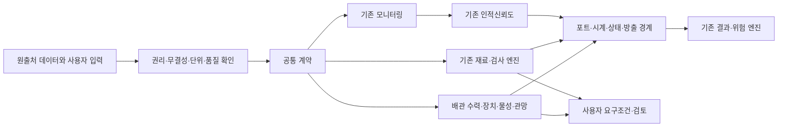

# 구조와 계산 책임

이 프로젝트는 모든 계산 엔진을 복사해 통합하는 방식 대신, 공통 계약과 배관
고유 계산을 제공한다. 실제 상태·관측·평가·판정은 서로 다른 정보다.

그림의 선은 책임 관계를 나타낸다. 모든 경로가 현재 완성된 실행 파이프라인이라는
뜻은 아니다. 실제 완료 범위는 `research/integration_results.json`에 기록한다.

## 패키지 구성

| 위치 | 책임 |
|---|---|
| contracts.py | 수치·압력·시계·자료 생성 방식·상태·근거 계약 |
| registry.py, builtins.py | 모델 메타데이터·입력 검증·실행·등록 |
| models/ | 새 배관 계산과 Fluids·ht 호출 |
| thermo.py | CoolProp와 교체 가능한 물성 공급자 |
| water.py | WNTR/EPANET 물 관망과 질량수지 확인 |
| epanet.py | 수력·수송 공통 엔진 실행, 단계별 경고와 수렴 통계 |
| water_quality.py | 성분·물 나이·출처 비율, 주입 시계와 모니터링 전달 |
| inverse.py, water_inverse.py | 공급자 기반 경계 파라미터 추정, 시간 분리와 관망 결합 |
| acoustics.py, acoustic_data.py | 동시 파형·지연·조건부 구간 위치와 공개 실험 판독 |
| workflow.py | 단위가 명시된 계산 의존 그래프 |
| requirements.py, procedures.py | 선언한 수치 기준·절차 근거의 별도 평가 |
| adapters.py | 기존 프로젝트의 실제 클래스와 엔진 호출 |
| datasets.py, loaders.py | 원출처 취득·검토와 선택 자료 스키마 판독 |
| catalog_data/ | 데이터·기술 범위의 기계 판독 목록 |
| research/ | 원본을 제외한 실행·취득·연동·배포 증거 |

## 중복을 피하는 경계

재료·부식·피로·파괴·검사·용접·다층 열전달은 `matintegrity`에 둔다. 같은
공식이 있어도 이 패키지에 다시 구현하지 않는다. 모니터링 검출기는 기존
`process-monitoring-toolkit`, HRA 추정은 `human-reliability-toolkit`을 사용한다.
방출·확산·화재·폭발·위험 집계도 해당 소유 프로젝트에 남긴다.

물리 연결 그래프, 계산 DAG, 작업 순서, 기능 의존과 FTA 논리는 서로 다른
그래프다. 같은 설비 ID를 쓸 수 있지만 연결 관계를 자동으로 같은 의미로
취급하지 않는다. HRA 실패 사건을 설비 고장 확률에 무조건 더하지 않는다.

## 추적성과 확장

인적 확률과 위험 엔진의 경계는 risk_exchange에 둔다. FTA·ETA·LOPA 수학은
기존 HRA를 호출하고 요구 시 실패는 기존 PRISM 객체로 전달한다. 같은 기능의
방호 ID, 조건 ID, 기회 분모와 상류의 소비 계보는 호출자가 검토해 일치시킨다.
빈도 endpoint로 보호 요구·방호 실패 조합·공정 제어 상실·봉쇄 상실·결과를 구분하며 물리
경로가 없는 인적 실패 횟수를 누설 빈도로 승격하지 않는다.

계산 결과는 상태·입력·출력·단위·실행 버전을 자체 보유한다. 작업 흐름은 부모
결과 해시를 추가한다. 외부 응답은 원래 스키마와 payload를 보존한다. 원래
외부 평가의 보류·연구 상태를 독립 검토 완료로 바꾸지 않는다.

새 해석 엔진은 먼저 기준 문제·데이터·허용오차를 정한 뒤 명시적 어댑터로
연결한다. 패키지 내부의 모델을 교체하더라도 동일한 단위와 적용 범위를
보장해야 한다. 사용자 모델의 정확성은 별도로 검증하고 버전 ID를 고정한다.
