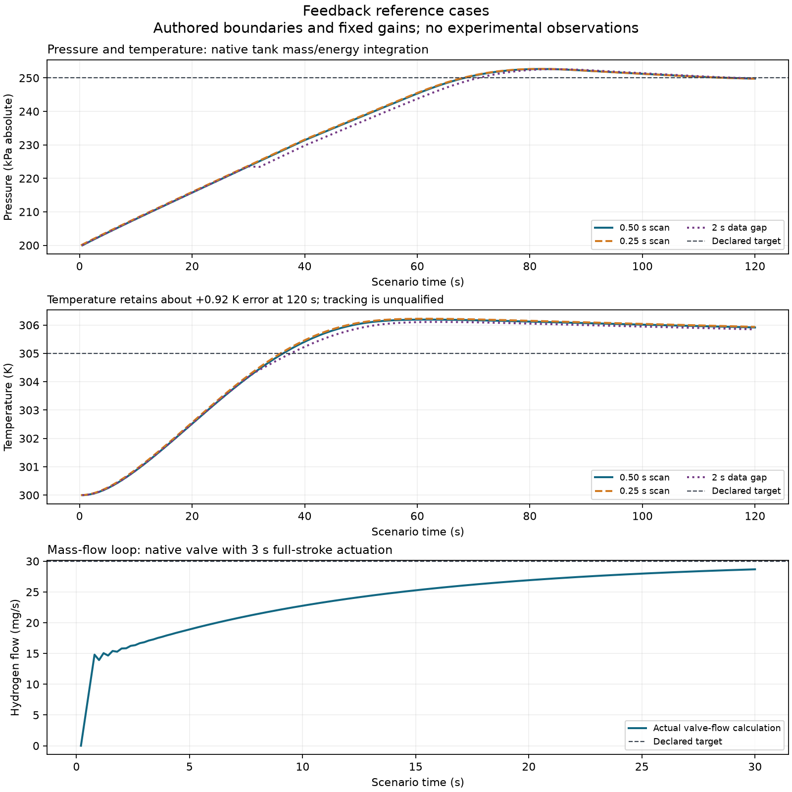

# 제어 명령·계측 시나리오·기존 공정 모델 연결

이 패키지는 기존 lh2dt_models의 PIDController와 FirstOrderTransmitter를 호출한다.
PID 수식·적분 방지·필터·양자화를 복제하지 않는다. 이쪽 책임은 단위·압력/영점
기준·시계·근거·결측 정책·상태 인수인계다. 반환 명령은 연구 계산이며 실제 장치
동작·방호 승인·인적오류 확률을 뜻하지 않는다. 전체 제어 기능 의존성은 부분 구현이다.

## 설치와 재현

원 lh2dt_models는 별도 설치한다. 이 패키지의 기본 설치만으로 계약을 작성할 수
있지만 실제 PID/계측 계산에는 원 엔진이 필요하다. 검증 스크립트는 읽기 전용
소스 위치를 받는다. 모니터링·HRA도 원 프로젝트를 사용한다.

```powershell
python examples/control_loop.py
python scripts/check_control_exchange.py --lh2dt PATH_TO_LH2DT --monitoring PATH_TO_MONITOR --hra PATH_TO_HRA
python scripts/plot_control_exchange.py
```

예제의 설정은 사용자가 바꿀 수 있다. 원료·설비·작업자 관측에서 추정한 이득이
아니며 실제 설비에 그대로 적용하는 기본 제어값이 아니다.

## PID API와 물리 기준

`control_exchange.ControlAxis`에는 quantity·canonical unit·reference_id를 넣는다.
압력은 absolute/gauge/differential을 추가한다. Pa라는 단위만 같아도 기준이
다르면 같은 관측으로 취급하지 않는다. 액위의 reference_id는 영점/바닥 근거,
유량은 기준 상태·방향·유량 정의의 근거를 식별하도록 작성한다.

| quantity | 단위 | 값의 의미 |
|---|---|---|
| pressure | Pa | 명시한 절대압·게이지압·차압 |
| temperature | K | 절대 온도 |
| mass_flow | kg/s | 선언한 방향의 질량 유량 |
| volume_flow | m3/s | 선언한 상태/방향의 체적 유량 |
| level | m | 선언한 영점 기준의 액위 |
| fraction | 1 | 0~1의 목표 비율 |
| power | W | 선언한 부호의 열·일률 명령 |

`PIDGains`는 세 이득 값과 각각의 단위를 받는다. 입력 단위 I, 출력 O이면
P는 O/I, I는 O/(I·s), D는 O·s/I로 정규화한다. 예를 들어 1/kPa를 1/Pa로
명시 변환할 수 있다. 공정 값 자체는 먼저 SI로 바꾸고 기준을 따로 확인한다.
단위가 맞지 않는 이득은 원 계산 전에 거부한다.

`PIDLoop`에는 loop_id, 관측 stream/channel, actuator_id, 두 axis, 이득,
출력 범위·bias·필터 시간·작동 방향, 최대 관측 나이·scan 간격, 결측 정책과
근거 ID를 넣는다. 자동 PID만 지원한다. 모드 전환·튜닝·제약 제어·인터록·
실제 구동기 추종에 대한 적분 보정은 아래 후속 범위다.

```python
from pipeline_integrity.control_exchange import PIDSession

session = PIDSession(specification, context, initial_time_s=0.0)
decision = session.step(decision_time_s, setpoint, observation)
checkpoint = session.checkpoint()

resumed = PIDSession(specification, context)
resumed.restore(checkpoint)
```

전체 입력과 단일 실행 예제는 examples/control_loop.py에 있다. context.asset_id는
loop_id, clock_id는 관측의 판단 시계와 같아야 한다. `ControlObservation`은
SignalFrame 또는 None, 동일한 axis, available_at_s, 근거 ID와 receipt를 보유한다.
수신 가능 시각과 관측 시각은 서로 다른 값이다. 참조 ID·기준압·단위·채널·
시계가 다르면 재표시하지 않고 거부한다.

## 판단 시계와 결측 처리

decision_time_s는 초기 시각 뒤에서 엄격히 증가한다. 같은 관측을 다시 쓰거나
이전 관측으로 되돌아가지 않는다. 미도착·미래·오래된·결측·invalid 관측과
scan 간격 초과는 needs_data다. 원 입력과 이유를 결과에 유지한다. 압력/온도·
액위·비율의 물리 범위 밖 값도 잘라 맞추지 않는다.

| 정책 | 반환 출력 | 내부 PID 상태 |
|---|---|---|
| withhold | null | 유지 |
| hold_last | 마지막 명령; 최초 명령은 반드시 공급 | 유지 |
| fixed_output | 명시한 범위 안의 fallback_output | 유지 |

이 출력 정책은 방호 승인이 아니다. 보류 뒤 첫 유효 관측은 기존 적분을 유지하고
이전 미분 관측/필터 속도를 초기화한다. 모르는 구간을 보간하거나 전체 공백 동안
적분하지 않는다. dt는 직전 판단부터의 시간이며 미분도 판단 시계를 기준으로 한다.
새 관측이 올 때마다 state를 갱신하는 이 정책을 PLC의 연속 ZOH 정책과 혼동하지 않는다.

checkpoint에는 요청·context·공급자 해시, 시각, PIDMemory, 마지막 출력/관측,
복구 플래그와 이전 결과 해시가 있다. 다른 설정/근거/공급자로 복구하거나 내용이
바뀌면 거부한다. 세션의 설정·공급자·정규화 이득을 재표시해도 거부한다. 해시는
변경 감지를 위한 것이며 서명·접근 통제·독립적인 교정 증거는 아니다.

## 계측 시나리오 API

`instrument_exchange.replay_transmitter(TransmitterScenario, frames, context)`는
원 FirstOrderTransmitter에 입력한다. bias·범위·resolution은 axis 단위,
bias_drift_per_s는 해당 단위/초다. accuracy_fraction_of_span은 원 모델의
명시적인 범위 기반 오차 한계이며 확률이나 랜덤 잡음이 아니다.

동적 필터는 왼쪽 원 값을 다음 표본까지 유지하는 ZOH 가정이다. 미래 표본으로
앞 구간의 필터를 구동하지 않는다. 초기 필터값을 반드시 명시한다. tau=0은
해당 시각의 현재 값을 즉시 읽어 불필요한 한 scan 지연을 만들지 않는다.
필터 뒤 표시 과정의 bias에 시간별 drift를 넣고, 원 포화·양자화 계산을 호출한다.

전송 delay는 available_at_s를 늦춘다. dropout은 [start,end)에서 표시의 valid를
false로 만들지만 알고 있는 물리 필터 상태를 파괴하지 않는다. 원 입력 자체가
미지이면 동적 상태도 미확정이다. 기본 withhold는 이후에도 보류하며 명시적
reset_on_next_valid만 새 유효 입력으로 초기화한다. tau=0의 현재 값은 이전
동적 이력 없이 다시 읽을 수 있다.

원 물리 시각 t와 별도로, 시나리오 시작 t0를 기준으로
reported=t0+(t-t0)·(1+rate_error)+offset을 기록한다. 이는 명시한 시계 오류
주입이며 실제 두 장치의 시계를 보정하거나 동일하게 만드는 추정법이 아니다.
offset 또는 rate error가 0이 아니면 별도 `reported_clock_id`를 명시해야 하며 출력
SignalFrame은 그 시계 ID를 갖는다. source clock과의 근거 있는 변환이 없으면 서로 다른
시계의 값을 합치거나 제어·모니터링 입력으로 해석하지 않는다.
음수 보고 시각은 0으로 자르지 않고 raw reported_time_s를 남겨 frame=None으로
표시한다. packet의 physical_source_time_s·reported_time_s·available_at_s를 구분한다.
주입 출력 origin은 항상 simulation이며 원 자료 origin·해시를 따로 보존한다.

`transmitter_monitoring_input`은 봉인된 송신기 replay 중 전달지연이 없고 source/report
clock이 같은 연속 packet slice만 기존
`MonitoringSplit`으로 바꾼다. source-row 순서·관측 ID·reported clock·단위·simulation
origin·invalid/dropout 행을 보존하고, source/replay digest를 별도 영수증으로 연결한다.
현재 PMT 입력 계약이 행별 `available_at_s`와 시계 변환을 받지 않으므로 전달 지연·시계
오류가 있으면 전체 slice를 거부하고 생략하지 않는다. 지연/시계오류 신호의 학습·평가
누수 방지를 위해 행별 availability와 source/reported clock mapping을 보존하는 원
모니터링 계약 확장이 필요하다.

`packet_observation(packet, axis=..., evidence_id=...)`로 PID 입력을 만들 수 있다.
지연·dropout·미래 보고 시각 때문에 제어 업데이트가 보류되는지 실제 원 PID로
검사했다. 보고 시각만 이용한 검사는 모든 실제 시계 오차를 탐지한다는 뜻이 아니다.
이 검사의 실행기는 현재 packet을 판단 시각에 제시해 미도착을 보류한다. 큐에서
이전에 도착한 표본을 선택하는 수신 정책은 호출자가 따로 명시해야 한다. 이번
9개 시나리오를 그러한 큐·보간·시간 보상이나 물리 폐루프의 검증으로 확대하지 않는다.

## 실제 실행과 검증의 한계

research/control_exchange_results.json에 기존 엔진의 포화 적분 방지·setpoint
변경 시 미분 kick 방지·작동 방향·checkpoint 왕복을 기록한다. 수소 단상 기체
탱크의 압력/온도 각 기본·시간 세분화·결측 사례 6개는 원 HomogeneousTank의
RK4 질량/에너지 장부로 실제 폐루프 실행했다. 앞 구간의 명령만 다음 상태 계산에
사용한다. 보류 시 장치에 0을 적용하는 가정은 실행기에 따로 명시한다.

기본 압력은 120초에서 목표 250000Pa 대비 약 -196Pa, 온도는 목표 305K 대비
약 +0.916K다. 온도는 이 시간창에서 목표에 수렴한 성능으로 승인하지 않는다.
밸브 유량 150판단에서는 원 유한 스트로크 구동기와 HEM 유량을 호출했다. 목표
3e-5kg/s 대비 마지막 오차는 약 -1.32e-6kg/s다. 명령은 위치를 즉시 바꾸지 않는다.
합성 장치/경계 조건이며 안정성·전 운전영역·현장 정확도 검증은 아니다.

9개 작성 계측 시나리오의 지수 응답 기준은 원 필터의 ZOH와 대조했다. 공개 탱크
관측 10실험에는 첫 시각을 초기 판단 기준으로 사용하고 이후 각 80개, 총 800개
shadow 명령을 계산했다. cm·영점·목표·이득은 가정이며 원 pump %를 대체하거나
새 공정 반응을 생성하지 않았다. 원 실험의 단위·형상 공백은 needs_data다.
원 관측 81행은 실제 모니터링 SignalBatch와 HRA SignalSeries에 시계·단위·결측을
유지해 전달했다. 명령을 observed 조치 완료나 HEP로 바꾸지 않는다.



전체 원/변환 관측과 상세 명령은 artifacts에만 남는다. 공개 그림은 자체 작성한
합성 폐루프 입력의 결과만 그린다. 재현 데이터·공급자 소스·코드 해시는 결과와
기존 DATA/THIRD_PARTY_NOTICES를 따른다. PI-X01/06에는 수동/자동 전환·실제 위치
추종·기한·인터록·동기화 근거와 인수 조건을 요청한다.
시계 오류는 별도 reported clock을 요구하며, 영 지연의 simulation trace만
`transmitter_monitoring_input`으로 기존 MonitoringSplit에 연결한다. 현재 monitoring
contract가 packet availability 시각을 보존하지 못해 지연 입력은 거부하며, owner 확장
요청 [PIPE-EXT-015](owner_requests/PIPE-EXT-015.md)에 수락 조건을 기록했다.
