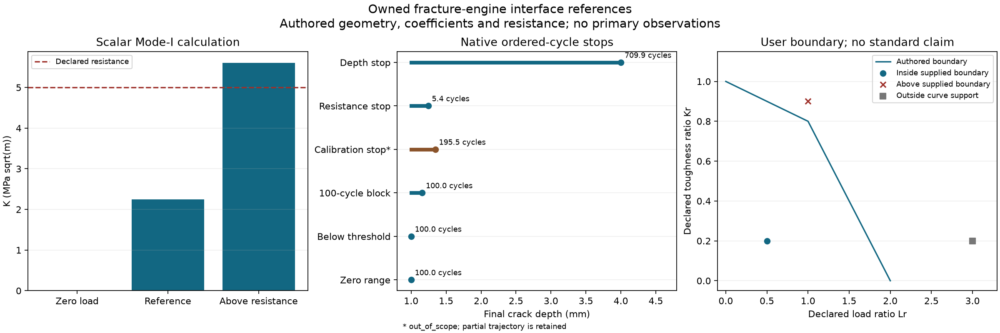

# 균열·성장·사용자 파괴 경계의 연결

이 경로는 기존 matintegrity의 Mode-I 응력확대계수, 일정 진폭/순서 있는 Paris
성장, 사용자 경계에 대한 파괴평가 좌표를 호출한다. 계산식을 복제하거나 기본
규격 곡선·형상계수·재료표를 포함하지 않는다. 원 결과·상태와 이쪽 입력의 정의·
재료·온도·위치·하중·회수·근거·해시를 함께 유지한다.

## 실행과 입력 검증

원 재료 엔진과 reader 의존성은 별도 설치한다. 수치 기준에는 SciPy, 데이터
판독에는 pandas, 그림에는 Matplotlib을 썼다. 모니터링과 HRA도 원 구현을 호출한다.

```powershell
python scripts/acquire_data.py --only crack_arrest --workers 1 --maximum-seconds 90
python examples/fracture_screen.py
python scripts/check_fracture_exchange.py --materials PATH_TO_MAT --monitoring PATH_TO_MONITOR --hra PATH_TO_HRA
python scripts/plot_fracture_exchange.py
```

예제의 균열·인성·성장계수와 경계는 모두 작성한 기준 입력이다.
실제 배관 재료나 공급자 값으로 해석하지 않는다. 원 소스는 실행 전후 해시로
확인하며 이 저장소에서 수정하지 않았다.

MaterialJob은 저장 가능한 JSON 작업이다. 이번부터 원 레지스트리의 strict
`run_json`을 사용한다. 중첩 tuple 계약은 JSON 배열에서 올바르게 구성되며 bool과
숫자·검토 플래그 문자열을 느슨하게 변환하지 않는다. 기존 MaterialClient.evaluate의
기본 경로는 strict Python으로 유지한다. 직접 호출할 때는 input_mode="json"을
명시할 수 있다. native context에는 JSON 검증 경로를 기록하고 receipt가 확인한다.

## Mode-I API

```python
from pipeline_integrity.fracture_exchange import assess_mode_i, assess_crack_growth

screen = assess_mode_i(mode_i_request, context)
growth = assess_crack_growth(growth_request, context)
```

전체 생성 입력은 examples/fracture_screen.py에 있다. FractureIdentity는 자산·
location·clock·재료 상태·flaw ID와 근거를 담는다. ModeIRequest에는 다음을 넣는다.

| 입력 | 의미 |
|---|---|
| crack_depth_m / wall_thickness_m | 양의 실제 길이; 균열이 벽을 관통하면 현재 범위 밖 |
| effective_opening_stress_pa | 검토한 순개구 하중; 절대 총응력이나 von Mises와 자동 동치가 아님 |
| opening_stress_definition | 응력의 정의·해석 기준 |
| geometry_factor와 지원 깊이 구간 | 사용자가 검토한 일정 형상계수와 적용 범위 |
| temperature_k | 인성/물성의 적용성 확인에 사용하는 온도 |
| FractureResistance | 재료 상태·값·정의·온도 범위·근거·검토 상태 |
| FractureReviews | 형상/응력 해·선형 탄성·하중/환경의 검토 |

인성 종류는 mode_i_initiation, crack_arrest, unqualified_observation,
synthetic_reference로 구분한다. Mode-I 개시 평가에는 검토한 mode_i_initiation
또는 작성한 synthetic_reference만 받는다. arrest/미검토 관측의 숫자를 KIC로
다시 표시하지 않는다. 정의에는 KIC/KJc 등 원 물리량과 시험 조건을 명확히 적고
별도 적용성 검토로 사용 가능한 개시 저항임을 설명해야 한다. 서로 다른 정의가
숫자와 단위만 같다는 이유로 호환되지는 않는다.

결측·미검토·재료 상태 불일치는 needs_data, 압축 개구 하중·형상/온도 지원 범위
이탈은 out_of_scope다. 압축을 0으로 자르지 않는다. 순개구 하중이 정확히0이면
원 K=0·유한 임계깊이 없음(null)을 보존한다. 결과 origin은 simulation이며 실제
인성 관측·방호 승인·실패 확률이 아니다.

status=computed도 저항을 초과할 수 있다. declared_resistance_outcome을 따로
확인한다. 원 critical_depth_m은 일정 계수/하중의 대수 값이다. 검토한 계수 깊이
범위와 벽 안에 있을 때만 qualified_critical_depth_m에 넣는다. 기준 예제의 원
임계값 약4.974mm는 계수 지원 상한4mm를 넘으므로 qualified 값은 null이다.
이를 잔여 허용 결함 크기나 수명으로 승인하지 않는다.

## 압력 단면에서 순개구 응력으로

`opening_stress_from_section(section, SectionOpeningMapping, context)`는 이전
PressureSection의 seal·자산·시계·하중 사례와 정확히 계산한 반경을 확인한다.
hoop 또는 axial 총응력 성분, 명시적 crack-face pressure, 추가 signed 응력과
스칼라 변환의 검토/근거를 받는다. 예제는 총응력+균일 crack-face 압력+추가
응력을 선언한 순개구 스칼라로 사용한다.

이 관계는 임의의 실제 표면 균열·깊이에 따라 바뀌는 응력·균열면 압력 분포의
일반 해가 아니다. 내벽 균열의 유체 압력이나 residual stress를 외부 대기압과
자동 치환하지 않는다. von Mises를 인장 개구 성분으로 사용하지 않는다.
미상 압력/미검토 변환은 needs_data이며 반경 보간은 자동 제공하지 않는다.

반환 mapping receipt의 digest·정의·값·context를 ModeIRequest와 함께 바인딩하면
변경되거나 다른 응력을 복사하는 것을 거부한다. 바인딩된 미확정 입력은 원
계산 없이 needs_data로 전파한다. 실제 K 해와 형상/하중 해는 별도 근거가 필요하다.

## 순서 있는 성장과 단위

CrackGrowthRequest는 초기/말단 깊이·벽·깊이별 형상계수 표, 순서 있는 하중
블록·회수와 counting_basis, 단일 온도·인성·GrowthCalibration을 받는다.
형상계수의 외삽은 없고 현재 원 솔버는 감소하지 않는 계수 표만 지원한다.
감소하는 표를 정렬/변형하지 않고 out_of_scope로 남긴다.

각 블록의 최소/최대 개구 응력은 Pa, 회수는 명시한 cycle 수다. 순서를 바꾸지
않고 블록 ID를 보존한다. source의 machine cycle index를 fatigue cycle count로
자동 변환하지 않는다. rainflow histogram을 실제 하중 순서로 해석하지 않는다.
반주기를 쓰는 경우에도 어떤 계수·손상 가정에서 계수화했는지 근거가 필요하다.

성장계수 C의 단위는 m/cycle/(Pa·sqrt(m))^exponent이다. 같은 길이·cycle 기준에서
MPa·sqrt(m) 계수를 옮긴다면 C_SI=C_reported·10^(-6·exponent)다. 길이가 mm이거나
다른 K 단위라면 그 변환도 필요하다. 필드에 SI 값을 공급하며 계수를 조용히
다른 단위로 해석하지 않는다. 실제 재료 계수·ΔK/R/온도 범위·threshold·인성은
각 근거와 적용성 검토가 있어야 한다.

원 variable_paris는 ΔK/R 지원 범위·threshold·인성·말단 깊이를 검사하며 평가된
회수·요청 회수·종료 이유·블록별 잔차를 반환한다. 보정 범위 끝에서 나온 부분
깊이/회수는 유지하되 전체 요청을 완료한 결과로 승격하지 않는다. requested
blocks 완료, 인성/깊이 한계 도달과 out_of_scope를 구분한다. 계산된 cycle 수를
초·연간 빈도·기간 파손확률로 바꾸는 모델은 제공하지 않는다.

혼합 모드·개시 수명·소성·부식/수소 환경의 별도 보정·과대하중 지연/폐구·
균열 상호작용·시간 의존 성장·동적 균열 정지·누설/파단 연성은 미완료다.
검토 플래그는 사용자가 공급한 적용성 기록이며 현장 자격을 생성하지 않는다.

## 사용자 경계의 파괴평가 좌표

`assess_failure_points(parameters, context, location_id=..., evidence_ids=...)`는
원 structural.failure_assessment_points를 strict JSON으로 호출한다. 사용자 허가
곡선·해 ID·재료 조건·K/저항·reference stress/정규화 강도를 공급한다. 하중 사례와
location·K/ref-stress/인성 근거 ID가 context와 맞아야 한다.

K 해는 탄성 등가응력과 같지 않고 reference stress는 단순한 임의 응력 선택이
아니다. 형상·소성 한계 해·저항/강도·하중 조합·곡선의 적용성을 따로 검토한다.
기본 규격 곡선·cutoff·계수표를 배포하지 않는다. 예제 다각선은 독립 작성한
인터페이스 기준이며 어떤 규격의 대용 곡선도 아니다.

computed+satisfied는 공급한 경계 안이라는 뜻이다. computed+not_satisfied는
경계를 초과한 계산, out_of_scope+unknown은 경계 지지 범위 밖이라는 뜻이다.
미검토는 needs_data다. 하나의 표준·사용 적합성·실제 시험 유효성·파손확률의
완료와 구분한다. 다른 저장소에 보낼 확장은 PI-X04, 위험 의미는 PI-X02를 따른다.

## 원시 균열 정지 실험

[Puyi Gao의 V1 자료](https://doi.org/10.17632/g69875w65c.1)는 CC-BY-4.0이다.
943565바이트 ZIP을 이전 취득 SHA-256과 대조했다. 공급자 체크섬이라고 부르지
않는다. crack_arrest_frames는 원 archive/member·시편 ID·원 sample clock을
검사하고 기존 reader의 N·m 단위 값과 laboratory origin을 반환한다.

18CSV·79341행의 전체 숫자를 독립 원 CSV 판독과 비교했다. 음수 force76285개,
machine displacement79341개, extensometer75250개를 유지했다. 장치의 부호를
임의 인장으로 바꾸거나 영점을 이동·필터·재표본화하지 않았다. 한 파일의 전체
header가 통째로 인용된 표기 결함은 원 reader가 처리하며 raw header hash와
표기 정규화 flag를 남긴다. 원 ZIP은 바꾸지 않는다.

reported temperature는 filename 유래 메타데이터이고 검증한 시편 온도 이력이
아니다. reported_cycle_index도 fatigue 회수를 계산한 결과가 아니다. 선택한
시편4631표본은 native monitoring/HRA에 전달했지만 HEP·실제 배관 운전·기한·
파손률이나 이벤트를 추정하지 않았다.

source_status는 needs_data다. 실제 기하·균열 길이·동적 reduction·유효성·
실제 온도 검토가 필요하다. 이 raw machine 자료에서 KIC·service lower bound·
Paris 계수·사용자 FAD curve를 만들지 않는다. 동적 arrest 계산은 여전히 계획 범위다.

## 검증과 이어가기

Mode-I5사례, 일정 진폭2사례, 순서 성장8사례, 압력 개구 바인딩1사례, 사용자
경계4사례를 실제 원 API로 실행했다. m=2/3의 일정 진폭 수명은 독립 수치 적분과
각각 약1.8e-15/1.1e-13cycle 차이였다. 일정 계수 기준의 말단 도달 회수는
약709.8804cycle, 보정 끝은 약195.4921cycle에서 out_of_scope, 별도 큰 하중의
인성 한계는 약5.4267cycle이었다. 모두 작성한 조건의 수치/계약 기준이다.



research/fracture_exchange_results.json에 원 상태·한계·source/implementation
hash를 남긴다. 원/변환 시험 행은 artifacts에만 있으며 그림은 작성한 기준이다.
MaterialClient의 기존 Python 경로도 실제 기본 연동으로 다시 확인했고 이전
고체 열/단면 기준은 JSON 경로로 재실행했다. 기존 무열 에너지 판정 문제는 유지했다.
