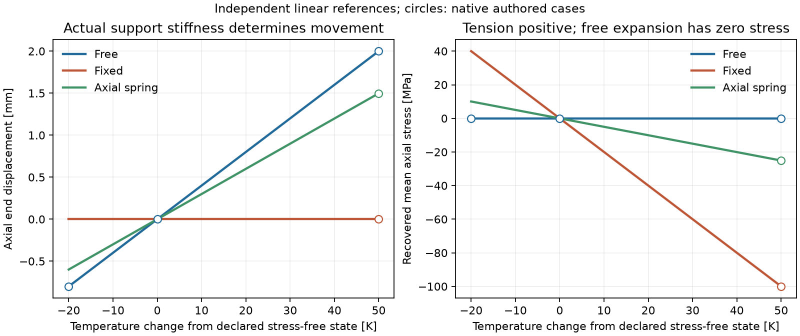

# 프레임의 균일 열팽창과 직선 관 압력 하중

`pipeline_integrity.frame_loading`은 기존 재료 엔진의 열 자유변형률·원통 응력을
프레임 하중으로 준비하고, `structural.solve_frame`의 선형 해석과 연결한다.
상태와 근거가 다른 열·압력 입력을 독립적으로 준비해 같은 원본 프레임에
조합할 수 있다. 구조 강성·Lame 응력·열 자유변형률 엔진을 다시 구현하지 않는다.
기본 구조 입력과 좌표·지지·하중의 의미는 STRUCTURAL_KO를 먼저 읽는다.

## 실행과 API

PyNite structural 선택 설치와 별도 MatIntegrity 소스/설치가 필요하다.

```powershell
python -m pip install -c requirements-tested.txt ".[structural]"
python examples/frame_loading.py --materials PATH_TO_MAT
python scripts/check_frame_loading.py --materials PATH_TO_MAT --monitoring PATH_TO_MONITOR --hra PATH_TO_HRA
python scripts/plot_frame_loading.py
```

예제의 `reference_frame`, `temperature`, `pressure_section`, `pressure_mapping`
함수는 전체 엄격 입력을 만든다. Python API에서는 다음 순서로 조합한다.

```python
from pipeline_integrity.frame_loading import (
    prepare_uniform_thermal_frame,
    prepare_pressure_frame,
    solve_loaded_frame,
)
from pipeline_integrity.material_exchange import evaluate_pressure_section

thermal = prepare_uniform_thermal_frame(frame, temperature_specification, context)
section = evaluate_pressure_section(pressure_specification, context)
pressure = prepare_pressure_frame(frame, section, pressure_mapping, context)
result = solve_loaded_frame(frame, (thermal, pressure), context)
```

두 준비 작업은 같은 변경 전 FrameRequest를 받는다. 각 결과인
FrameLoadContribution에는 원 프레임·context 해시, 정의·상태·원 소유 결과,
추가할 집중하중·초기변형률과 자체 해시가 있다. `ready`는 준비 완료를 뜻하며
구조 계산 완료가 아니다. 준비 후 시각·기하·지지·기존 하중·context가 바뀌면
다시 준비해야 한다. 같은 효과를 중복 조합하거나 같은 ID를 재사용하면 거부한다.

준비 대상 하중 경우는 원본 프레임에서 사용하지 않은 것으로 선언한다.
예제는 thermal·pressure 경우를 각각 만들고 조합 계수를 제공한다. 계수는
이미 정의한 초기변형률과 하중을 배율 조정하며 절대 온도를 곱하지 않는다.
온도 의존 물성의 상태 변경을 선형 조합으로 대신하지 않는다.

## 초기변형률과 실제 부재력

FrameRequest의 `initial_strains`에는 FrameInitialStrain을 선언할 수 있다.
member/case·signed 무응력 축변형률·근거·종류·균일 축 가정 검토를 제공한다.
값 None이나 미검토는 엔진 호출 전 needs_data다. 종류는 thermal,
pressure_poisson 또는 사용자가 선언한 declared_uniform_initial이다.
변형률 속도나 누적 시간 손상으로 해석하지 않는다.

명시한 각 항의 균일 변형률을 ε₀, 해당 부재의 강성을 EA라고 하면 i→j 축
방향으로 -EAε₀, +EAε₀의 등가 절점 힘을 만든다. 이것은 초기변형률을
강성 해석에 전달하는 수단이다. 실제 외력의 목록이나 정규화 크기로 세지 않는다.

해석 후 등가 힘을 부재 끝 작용에서 제거해야 실제 부재력이 된다.
원 엔진의 압축 양수인 단면 축력을 N_native라 할 때 인장 양수의 복원 축력은
`N = -N_native - EAε₀`다. 원 local end vector의 축 성분에는 i에서 +EAε₀,
j에서 -EAε₀를 더하고 전역으로 회전한다. 합성된 ε₀는 해당 조합 계수를 포함한다.

이에 따라 자유 팽창의 끝 변위는 ε₀L이고 실제 축력은 0이다. 양 끝이 완전히
구속되면 변위는 0, 축력은 -EAε₀다. 스프링·다른 부재·지점 이동이 있으면
실제 지지 강성과 연결 관계로 구속을 계산한다. 임의의 구속률을 곱한 응력을
미리 프레임에 더하지 않는다.

반환 필드의 의미는 다음과 같다.

| 필드 | 의미 |
|---|---|
| axial_n | 원 엔진의 압축 양수 축력. 초기변형률 보정 이전 원값 |
| elastic_axial_force_tension_positive_n | 초기변형률 보정 후 인장 양수 축력[N] |
| mean_elastic_axial_stress_pa | 복원 축력/단면적. 굽힘·비틀림을 포함한 국소 응력이 아님 |
| initial_strain_adjusted_local/global_end_actions | 실제 부재 끝 작용, i/j 각 6성분 |
| uniform_stress_free_axial_strain | 조합 계수를 반영한 부재의 ε₀ |
| nodal_balance | 각 노드의 복원 부재 끝 작용 = 실제 집중하중+반력 검사 |

전체 외력/모멘트 수지에 더해 노드별 힘/모멘트 수지를 독립 검사한다.
등가 초기변형률 힘은 두 검사에서 실제 외력으로 다시 넣지 않는다.
기본 maximum_axial_strain_magnitude=0.01로 무응력·평균 탄성·평균 전체
축변형률을 검사한다. 이 값은 재료 허용값이나 항복 판정이 아니다. 부재 샘플의
축량을 검사하며 굽힘 표면 변형률·연속 곡선의 극값 자격은 남는다.

## 균일 온도 입력

UniformFrameTemperature는 목표 member/material/case와 현재 절대 온도·무응력
기준 절대 온도[K], 상수 α[1/K], 계수가 검토된 온도 구간, 근거와 균일 온도/
상수 계수 검토를 받는다. 현재와 기준 온도가 모두 구간 안에 있어야 한다.
기준 온도를 초기 관측이나 주변 온도로 자동 가정하지 않는다.

준비 함수는 원 mechanics.thermal_restraint를 restraint_fraction=0으로 호출하고
free_thermal_strain만 입력한다. 원 검토 작업·응답·버전·단위를 보존한다.
실제 구속은 프레임이 계산한다. 현재 이 소유 모델의 상수 α는 음이 아닌
값을 지원한다. 음의 팽창계수·온도 의존 계수·상변태에는 다른 검토한 공급자와
별도 적용성 근거가 필요하다. 저수준 FrameInitialStrain은 signed 값을 보존한다.

벽 두께/원주/길이 방향 온도 구배와 초기 곡률은 현재 열 준비 함수의 범위 밖이다.
이 열처리 계산은 동적 온도장을 직접 풀지 않는다. 기존 열 모델과 연결할 때도
셀 평균·센서 점 값·유체/벽 온도를 같은 것으로 바꾸지 않는다.

## 압력 입력과 Poisson 보정

PressureFrameMapping은 계산한 PressureSection 결과의 해시, source location,
목표 member/case, 근거와 직선 균일 원통·끝 조건/total 압력·Poisson 검토를 받는다.
원본 및 내부 MaterialReceipt 해시·원 모델·입력·단위·asset·clock·정확한 시각을
확인한다. 프레임의 A/Iy/Iz/J가 원통의 환형 단면과 일치해야 한다. 현재 자동
압력 준비는 연결 차수가 각 끝에서 1인 독립 직선 span을 지원한다. 분기·엘보의
하중 경로를 자동 추정하지 않는다.

원통의 σr+σθ를 재료 결과에서 읽는다. 이는 지원하는 균일 원통에서 반경에
따라 일정해야 한다. E·ν가 같은 선언한 등방성 프레임에 축 초기변형률
`εp = -ν(σr+σθ)/E`로 전달한다. 닫힌 끝의 실제 cap 힘은 각 면의 절대 압력과
면적을 써서 `Fcap = pi·πri² - pe·πro²`로 구하고 원 axial stress×벽 면적과
대조한다. 열린 끝은 cap 힘이 0이다. 압력은 프레임의 양 끝에 실제 외력으로
적용하며 εp의 등가 힘과 구분한다.

끝단 추력만 넣으면 압력에 의한 축 변형에서 Poisson 효과가 빠진다. 이
연결은 자유·구속 상태에서 `εz = σz/E - ν(σr+σθ)/E + εthermal`을 만족하도록
한다. 원 닫힌 끝 σz를 프레임이 복원한 σz에 다시 더하지 않는다. 고정 조건의
σz는 원 자유 닫힌 원통의 σz와 달라질 수 있다.

예제의 ri=0.09m·ro=0.1m·pi=2MPa(abs)·pe=0.1MPa(abs)에서 자유 닫힌 관의
축응력은 약 8MPa, 압력에 의한 축변위는 0.064mm다. α=1e-5/K·ΔT=50K를
함께 적용하면 자유 변위는 약 2.064mm, 완전 구속 평균 축응력은 약 -95.2MPa다.
이 수치는 작성한 탄성 기준 문제이며 상용 관종·규격의 허용값이 아니다.

응력은 total stress 기준이다. 같은 내외 절대 압력의 정수압 압축도 지워지지
않는다. 이 축력은 기하 강성/좌굴에 쓰는 유효 축력으로 자동 승격하지 않는다.
기준 압력·열/기세·부속품·지지의 이중 반영을 검토해야 한다. 실제 유체 재고/
관 벽 변형의 양방향 피드백, follower pressure, 유동 기세·압력 구배·엘보 유연성·
접촉·좌굴·점소성·실제 국소 응력은 후속 범위다.

## 공개 온도차 자료의 조건부 적용

Tomanek·Stutts 자료의 50cu3는 주변 대비 온도차[K]를 제공한다. 원 1937행 중
처음 16개 시각을 사용했다. 예제는 주변과 가정한 프레임의 무응력 온도를
둘 다 293.15K로 별도 선언하고, tc1의 온도차를 균일 프레임 온도로 대입했다.
실제 봉재의 형상·온도 균일성·초기 응력·팽창계수를 알아낸 것으로 표시하지 않는다.

원 SignalFrame과 온도 기준·source hash·clock을 상세 결과에 남기고 계산
origin=simulation을 유지했다. 고정 프레임 반력의 독립 기준과 최대 차이는
약 3.28e-10N였다. 16×24 모니터링 배치와 16표본 HRA 신호의 원 시각도 대조했다.
원 관측·상세 가정 결과는 artifacts/frame_loading에만 두고 공개 요약은 집계다.
추가 파일 확보로 집계하지 않으며 실제 응력·HEP의 독립 검증은 아니다.

## 검증과 인수인계

26개 새 검사와 기존 구조 25개 검사는 자유/고정·냉각·스프링·다른 부재 구속·
3D 연결·조합 배율·보정 힘·하중 준비 변경/중복·누락·온도 구간·압력 조건·
시계/형상/근거·초기변형률 한계를 확인한다. 실제 소유 엔진의 별도 실행은
20작성 사례 중 17계산과 3보류, 원 온도차16snapshot을 기록한다. 원 프레임
14사례·공개 하중32snapshot도 새 부재력/노드 수지 구현으로 다시 실행했다.



방법 검토는 [INL MOOSE의 열 고유변형률 정의](https://mooseframework.inl.gov/source/materials/ComputeThermalExpansionEigenstrain.html),
[원 PyNite 부재 기능](https://pynite.readthedocs.io/en/latest/member.html),
[Bower의 원통 탄성 해석](https://solidmechanics.org/text/Chapter4_1/Chapter4_1.htm)과
[OpenSees의 열 하중 기능](https://opensees.github.io/OpenSeesDocumentation/user/examples/thermalExamples/thermalexample2.html)을
확인했다. 실제 실행은 기존 PyNite/Mat 소유 경로를 사용했고 다른 엔진 코드나
예제·규격 곡선·계수를 복사하지 않았다. 자료 credit은
[Tomanek·Stutts, Mendeley V1](https://data.mendeley.com/datasets/sbcf36976g/1), CC-BY-4.0다.
