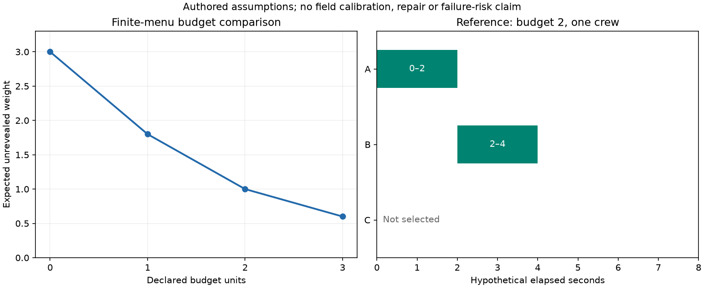

# 검사 후보·방법·시각 선택

`pipeline_integrity.inspection_planning.plan_inspections`는 유한한 검사 메뉴를 기존
`scheduling.solve_schedule`로 컴파일한다. 검출확률과 무지시 관측의 베이지안 갱신은
기존 MatIntegrity의 `inspection.logistic_pod`, `inspection.no_indication_update`를
호출한다. 별도 POD·Bayes·일정 최적화 엔진을 복제하지 않는다.

현재 범위는 위치별로 이번 계획에서 검사하지 않거나, 검토한 방법·예약 시각 중
한 가지를 고르는 연구 API다. 여러 회차의 적응형 검사 주기, 결함 성장·수리·파손의
동적 정책과 전체 위험 최적화는 후속 범위다. 기술 목록의 inspection_selection은
partial이며 현장 검사 주기를 산정했다고 표시하지 않는다.

## 설치와 실행

기존 MatIntegrity 프로젝트를 별도로 설치하고 이 패키지의 scheduling 선택 의존성을
설치한다. 그림 재생성에는 figures도 필요하다.

```powershell
python -m pip install ".[scheduling,figures]"
python examples/inspection_campaign.py
python scripts/check_inspection_planning.py --materials PATH_TO_MAT
python scripts/plot_inspection_campaign.py
```

검증 스크립트의 공개 ILI 사례는 먼저 기존 `scripts/apply_ili.py --materials
PATH_TO_MAT --joints 14 --reuse-scans`로 만든 전체 검사 캐시를 사용한다. 캐시가
없으면 원자료를 취득하고 해당 명령을 먼저 실행한다. 원자료·캐시·변환된 표는
배포에 포함하지 않는다. 검증은 원 ZIP의 SHA-256, 캐시 내용 해시, 요청·판독기·
스키마·openpyxl 버전의 키를 확인한다.

## Python API와 입력

```python
from pipeline_integrity.inspection_planning import plan_inspections

result = plan_inspections(campaign, context)
result.check_integrity()
if result.status in {"optimal", "feasible"}:
    selected = result.selected
    shared_schedule = result.schedule
```

| 입력 | 필수 의미 |
|---|---|
| InspectionHypothesis | 고유 가설 ID, 사전 질량, 평가 시점의 미발견 가중량, 근거 |
| InspectionTarget | 실제 위치 ID, 가설들, 검사 선택 메뉴, required 여부 |
| InspectionOption | 방법 ID, 시작·소요 초, 가설별 검사 당시 크기(m), 검출 모델, 피복률, 자원·예산 |
| InspectionCampaign | 계획 기간·시간 격자, 자원 달력, 예산, 점수 해상도·단위·근거 |
| RunContext | 공통 설비·시나리오·시계, 모든 입력 근거 |

가설 질량은 합이 1이어야 하며 임의 정규화하지 않는다. 모든 메뉴는 같은 가설
ID를 유지해야 한다. 위치별 중복 Target은 거부한다. 반복 검사의 의존을 별도
위치로 숨기지 않는다. 가설 간 독립을 가정해 사업장 파손 확률을 만들지 않는다.

검출 모델은 검토한 범위의 로그 크기 곡선 또는 사용자가 준비한 가설별 POD 벡터다.
곡선 계수·지지 범위·관측의 분야 적합성은 근거로 선언한다. 0 크기의 상태에는
검출확률 0을 요구하며 허위 지시는 현재 모델에 포함하지 않는다. coverage는 가설과
독립적인 무작위 피복률이라는 원 엔진의 가정을 유지한다. 특정 부위를 의도적으로
검사하는 피복을 같은 분수로 바꾸지 않는다. 검토한 크기 범위 밖은 needs_data다.

서로 다른 검사 시각의 크기는 사용자 또는 기존 성장 모델이 계산해서 가설 ID에
맞춰 공급한다. 여기서 연도 라벨로 경과 시간을 추정하거나 성장 모델을 자동 적합하지
않는다. 평가 가중량은 공통 horizon의 기준이며 검사 시각에 따라 다른 모집단을
몰래 사용하지 않는다. 이미 보고된 결함의 재검사와 미발견 결함 탐색도 구분한다.

## 목적값의 해석

각 메뉴에서 원 엔진은 무지시의 가능성과 그 조건에서의 가설 질량을 반환한다.
이 API는 그 조건부 가중량 평균에 무지시 가능성을 곱해 **아직 드러나지 않은
가중량의 기대값**으로 집계한다. 무지시 후의 조건부 질량만으로 사전 계획을
비교하지 않는다. 검출되면 이 기준에서 ‘미발견’ 항목이 사라진다는 뜻이며,
실제 수리·물리 위험 감소·검사원의 성공을 자동으로 인정한다는 뜻이 아니다.

완전한 검출로 무지시 가능성이 0인 입력에서는 원 엔진이 조건부 갱신을
out_of_scope로 반환한다. 해당 상태를 보존하고 조건부 posterior는 null이다.
이 특별한 입력의 무조건 미발견 기여만 0으로 계산한다. 일반적인 오류나 미지의
원 결과를 0점으로 바꾸지 않는다. 필요한 메뉴 하나라도 미확정이면 전체 캠페인은
needs_data이며, 그 메뉴를 삭제한 뒤 최적해라고 발표하지 않는다.

## 일정·자원과 반올림

검사 메뉴는 공유 일정 엔진의 OperationMode로 옮긴다. 새 모드별
earliest_start_s·latest_finish_s를 해당 선택이 활성화될 때만 적용한다. 고정
예약은 시작과 소요 기간으로 표현한다. 작업의 전체 창과 모드의 창을 함께 지켜야
한다. 독립 일정 감사도 선택된 모드의 창을 검사한다. 시간은 지정 격자에 정확히
놓여야 하며 반올림하지 않는다. 자원 구간은 [시작, 종료)이고 예산 사용량은
선택된 검사에만 적용한다. required이면 미선택 메뉴를 만들지 않는다.

최적화 목적은 메뉴 점수를 score_quantum으로 나눈 **올림 정수 비용**의 합이다.
금액과 자원은 별도 제약으로 유지하며 점수와 더하지 않는다. ‘미선택’도 원 기준의
가중량을 가진다. CP-SAT의 하한·격차·primal 감사를 공유 엔진에서 그대로 받는다.
최적성은 이 올림 목적에 한정하고 unrounded_score_proven_optimal은 false다.

Target 수가 N, 해상도가 q이면 올림 오차 합은 Nq 이하다. 최적화의 정수 하한 L로
부터 원 모델 점수의 하한 max(0, (L-N)q)를 보고하고 선택안의 반올림 전 합을 상한으로
제공한다. 이는 반환된 수치 모델 점수의 범위이며, 실제 검출 성능의 신뢰구간이나
파손 위험의 확률 범위가 아니다. 정수 비용 예산을 넘는 과도한 해상도는 거부한다.

## 실제 실행과 공개 자료

독립 작성한 예제는 가상 후보 A/B/C와 예산·작업자 조건이다. 예산 0/1/2/3에서
미발견 가중량은 각각 3.0/1.8/1.0/0.6이다. 예산 2에서는 A를 0–2초, B를 2–4초에
검사하고 C는 선택하지 않는다. 수치는 현장 시간이나 검출 계수가 아니다.



실제 원 Mat·CP-SAT 호출 11사례는 `research/inspection_planning_results.json`에
기록했다. 예산·피복 변화, 필수 검사의 충돌, 지원 크기 이탈, 불가능한 무지시를
검사했다. 정책 검사의 고정 응답 spy는 별도이며 원 확률 엔진을 재구현하지 않는다.

공개 ILI의 13개 실제 후보에는 검출의 독립 정답/미검출 표본, 교정된 POD,
사전 질량, 실제 작업 자원·시각이 없다. 그 상태는 needs_data다. 가정 곡선을
부착한 전체 13개에서도 4개 깊이가 지지 범위보다 작아 보류된다. 원자료를 바꾸거나
곡선 범위를 넓히지 않았다. 범위 안의 9개를 명시한 **별도 가상 부분 문제**에서
96개 실행 가능한 메뉴를 독립 열거해 올림 목적의 최적성을 비교했다. 이를 전체
13개 계획이나 실제 검사 성능 검증으로 대체하지 않는다. 제외 ID와 각 원본 해시는
기록에 남는다. 이 부분 문제의 사전 질량·POD·시각·자원·가중량은 모두 가정이다.

## 다음 연구와 방법 검토

PI-X04에는 알려진 정답·미검출·허위 지시·반복 시편·검사자·방법·작업 조건을
보존하는 데이터 계약과, 크기 범위·불확실성·동일 결함 계보를 가진 검출 응답을
요청했다. 공동 검출·피복 의존, 여러 회차의 검사·수리 정책과 물리 파손 기준을
확보한 뒤 동적 계획으로 확장한다. 제한된 입력에 맞춘 선별 예제를 전체 RBI나
규격 충족으로 표시하지 않는다.

공개 방법 비교에는 [NASA NTRS의 검사 신뢰도 연구 설계 소개](https://ntrs.nasa.gov/citations/20220013822)와
[OR-Tools의 정수 최적화 설명](https://developers.google.com/optimization/cp/cp_solver)을
확인했다(2026-10-27). 다른 산업 분야의 검사 자격을 배관으로 자동 이전하지 않는다.
규격 문장·표·교정 계수는 가져오지 않았다. 새 복잡한 검출 모델을 넣기 전에
필요한 정답 자료와 적용성·독립 검증부터 확보한다.
