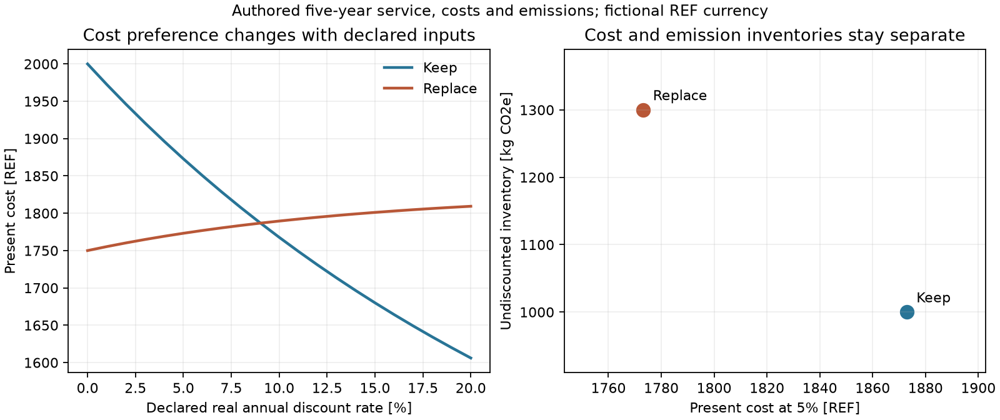

# 선언한 정비·교체·생애주기 비용과 배출 비교

`pipeline_integrity.lifecycle`은 동일 서비스·연구 기간·가격/배출 경계를 선언한
대안의 현재비용과 CO2e 재고를 비교한다. `lifecycle_exchange`는 전력 관측,
기존 일정 결과와 기존 위험 빈도를 명시한 비용·배출 항목으로 연결한다.
투자 실행·정비 승인이나 실제 장치의 교체 필요성을 판정하는 모델은 아니다.

## 실행

```powershell
python examples/lifecycle_study.py
python -m pytest tests/test_lifecycle.py -q
python scripts/check_lifecycle.py --hra PATH_TO_HRA --monitoring PATH_TO_MONITOR
python scripts/plot_lifecycle.py
```

기본 비교와 전력/금액 계약은 필수 의존성만 사용한다. 실제 일정은 scheduling
선택 설치, 실제 HRA/모니터링 교환은 각 소유 프로젝트가 별도로 필요하다.
예제의 REF는 가상 통화다. 비용·배출량·할인율·요금·운전 횟수는 작성한 가정이며
시장 자료나 정부 지정값을 가져오지 않았다.

## 입력과 가격 기준

| 계약 | 내용 |
|---|---|
| MoneyBasis | 통화 식별자, 기준연도, constant 또는 nominal 가격 |
| Money | signed 금액 또는 None과 MoneyBasis |
| CostEvent | 지급 시각[s], 비용 종류, Money와 근거 |
| RecurringCost | 첫 시각·간격·정확한 횟수, 기준시점 가격과 실질/명목 상승률 |
| EmissionEvent | 시각·signed kg_CO2e 또는 None, 영향지표/GWP 정의 ID와 근거 |
| LifecycleAlternative | 같은 서비스와 비용/배출 경계, 세 재고 목록과 검토 상태 |
| LifecycleStudy | 자산·재무 시계·기간·1년 길이·가격/할인 기준·대안·기준 대안 |

금액의 양수는 지출, 음수는 수입/잔존가치/명시한 credit이다. 잔존가치를
수명 비례로 추정하지 않는다. 지급 시각은 연구 기준시점으로부터의 경과 초다.
통화·가격 기준연도·constant/nominal 구분을 대안 사이에서 일치시켜야 한다.
환율이나 과거 금액의 기준연도 변환을 자동 수행하지 않는다.

constant 금액에는 실질 할인/상승률, nominal 금액에는 명목 할인/상승률을
사용한다. 다른 기준을 섞으면 입력을 거부한다. 연간 할인율 None은 알 수 없는
입력이며 0으로 바꾸지 않는다. 할인율과 상승률은 -1보다 커야 하고 음수를
보존한다. RecurringCost의 quote는 기준시점 가격이며 각 지급시점까지 상승시킨다.
nominal quote에 이미 반영한 물가상승을 별도 인자로 다시 더하지 않는다.

CostEvent의 nominal 금액은 해당 지급시점의 명목값이다. RecurringCost의 quote는
연구 기준시점 금액으로 두고 명시한 상승률을 적용한다. nominal의 base_year는
재무 기준시점의 연도이며 모든 미래 지급을 그 해의 명목가격으로 바꾸지 않는다.

RecurringCost는 마지막 시점까지 임의 반복하지 않고 occurrences 횟수만 생성한다.
요청한 마지막 지급이 연구 기간을 넘으면 거부한다. 기간 끝의 교체 비용을
자동 생성하거나 지우지 않는다. horizon_tolerance_s는 경계 수치 오차 허용값이며
실제 지급 시각은 반올림/클리핑하지 않는다. 기본 생성 비용 항목 예산은100000개다.

동일 서비스·비용 경계·배출 경계 ID와 functional_equivalence_reviewed를 요구한다.
이 검토는 입력 선언이다. 실제 대안의 유량·품질·안전·가용성·수명 등가성을
이 계산이 실증하지 않는다. 비용과 배출 목록은 명시적으로 빈 tuple을 줄 수
있다. 빈 재고는 검토 후 0이며, 값 None이나 미검토 재고는 0이 아니다.

## 하나의 현금흐름 계산을 재사용

각 대안의 사건/반복 비용을 ledger로 펼친 뒤 기존 `economics.cashflow`를 호출한다.
새 할인 엔진을 중복 구현하지 않는다. 원 계산의 입력·시각·단위·버전·context·
소스 해시를 native_cashflow에 보존한다. 같은 시각의 여러 비용이나 입력 순서를
정렬·병합해서 지우지 않는다. 종류별 현재비용도 이 원 계산값에서 합산한다.

해당 원 모델은 version2에서 optional times_s를 받는다. 제공하지 않으면 기존과
같이 첫 값이 시각0인 등간격 현금흐름이다. 제공하면 각 time_s/period_duration_s의
실수 기간으로 할인한다. 같은 모델의 이전 입력이 계속 동작한다. `economics.energy`
version2는 signed 요금을 허용하고 모르는 요금/배출계수를 None으로 유지한다.
범위가 큰 수치 연산에서 overflow/underflow가 발생하면 out_of_scope로 보류한다.

각 대안은 cost_status와 emissions_status를 따로 갖는다. 비용이 완전한 모든
대안에 대해 최저 현재비용과 기준 대안 대비 절감액을 반환한다. 배출이 미상이어도
완전한 비용 재고의 비용 비교는 가능하지만 결합 비교는 보류한다. 하나라도 비용이
미상이면 나머지만으로 가장 싼 대안을 고르지 않는다.

배출량은 할인하지 않는다. 비교하려면 같은 CO2e 지표·환산/기간 정의와 경계를
명시한다. 최저비용·최저배출 후보와 두 값의 exact 지배 관계에 따른 비지배 집합을
분리한다. 금액과 kg_CO2e를 임의 점수로 더하지 않는다. 최저값의 동률 허용값은
비용/배출 각각 설정하며, 비지배 관계는 원 수치의 정확한 대소 비교다.
탄소 가격·세금·금융·환경 영향 계수는 자동 추정하지 않는다. 외부에서 검토한
명시적 비용/CO2e 항목을 추가할 수 있다. 전체 다중 환경영향 LCA를 수행하지 않는다.

## 전력 신호와 비용

PowerIntegration과 integrate_power_frames는 SignalFrame의 시계·스트림·채널·
단위·origin을 확인하고 인접 표본 사이를 선형 적분한다. 단위는 W로 명시적으로
변환한다. 원 시각 순서를 바꾸거나 gap·결측·관측 이후 꼬리를 채우지 않는다.
invalid 또는 긴 간격을 건너뛰면 부분 에너지/기간을 보존하고 needs_data다.

nonnegative_consumption은 음수 전력에서 out_of_scope다. 사용자가 물리적
의미를 검토해 signed_import_positive로 선언하면 0교차 위치에서 각 구간을
나눠 수입/수출 에너지를 따로 적분한다. 양 끝의 양수 부분만 trapezoid로
적분해 교차 구간을 과대 산정하지 않는다. 부호를 절댓값으로 바꾸지 않는다.

EnergyValuation과 value_power_energy는 원 integration 해시·원 자산을 바인딩한다.
재무 시각, 명시한 횟수 배율, 가정한 수입/수출 요금·배출/credit 계수·지표와
매핑 검토가 필요하다. 연간 운전 횟수나 대표성은 관측에서 자동 추정하지 않는다.
완전한 적분에 대해 원 economics.energy를 수입/수출 각각 호출하고 검토한
수출 credit을 차감한다. 미상 요금과 배출계수는 서로 다른 결과에 None으로 남는다.
원 범위 이탈도 비용 사건의 valuation_status로 전달한다.

공개 UCI EPS1의4회차는 각각6000표본·100Hz다. 각 시계의 표본 구간은0~59.99초다.
독립 trapezoid와 적분값을 대조하고 마지막0.01초를 더하지 않았다. 24000원값과
시간을 판독기와 대조했고 실제 모니터링/HRA 클래스에도 전달했다. 재무 계산의
100000회 배율·0.2REF/kWh·0.4kg_CO2e/kWh는 검증용 가정이다. 원 고장 profile을
교체 비용·장치 수명·운전 빈도·투자 절감률로 바꾸지 않았다.

자료에서 평가한 에너지·일회성 계획 작업·미계획 재작업은 기본 정기정비 견적에
포함하지 않은 공유 추가 항목으로 두 대안에 동일 적용했다. 실제 대안별 효율·
위험 감소나 경제적 절감 차이를 이 관측에서 추정하지 않는다.

## 일정과 위험 결과의 비용 연결

ScheduleValuation은 감사가 통과한 feasible/optimal 일정, 결과 해시·자산·
시계 원점 매핑·선택 모드와 요금 근거를 요구한다. 지급 시점은 start/finish로
선언한다. 각 작업은 고정 비용+선택된 계획 기간×명시한 초당 요금으로 계산한다.
최적화 objective의 점수나 fixed_cost를 통화로 자동 해석하지 않는다. 불가능하거나
감사에서 보류된 일정은 비용에도 보류 상태를 전달한다. 계획 시각은 실제 완료나
현장 downtime 관측이 아니다. 같은 매핑에서 작업별 비용을 중복 부과하지 않는다.

ExpectedLossValuation은 source binding이 일치하는 RiskFrequency를 받는다.
단순 HEP·불가용도·기간 확률을 연간 횟수로 취급하지 않는다. 조건·endpoint·
원 자산, 기간과 1년의 길이, 조건부 평균 손실·손실 성분·지급 시점과 검토가 필요하다.
선언한 일정 평균 빈도에 대해 빈도×노출 기간[year]×조건부 평균 손실을 계산한다.
이 결과는 평균값이며 손실 quantile·최대 손실·실제 사건/실패율은 아니다.

같은 빈도 binding과 같은 손실 성분의 겹치는 기간을 한 대안에 중복 집계하면
거부한다. 다른 빈도/부모·자식 사건 사이의 손실 배타성은 이 규칙만으로 증명하지
못한다. ET/FTA 결과를 합할 때 원 partition·조건·소비된 사건·방호와 비용 경계를
검토해야 한다. source/year 의미와 지급 시점의 근거도 필요하다. 일정 비용과
사고 재작업 비용의 동일 손실을 중복 넣지 않는다. 원 위험 엔진은 복제하지 않는다.

ValuationSource는 원 응답, 가정, source/event digest와 computed/needs_data/
out_of_scope를 보존한다. 준비 후 비용·시간·기준·근거·valuation context 또는 source가 바뀌면
검증에서 거부한다. source 자료 공백이나 범위 이탈을 0원으로 바꿔 순위를 만들지 않는다.

## 검증과 다음 연구

25개 검사는 독립 할인 기준, 음/0 할인율·signed 요금·None, 일관된 실질/명목
결과 일치, 가격/서비스/기간 충돌, 재고/동률/배출·생성 예산, 0교차·missing/gap/
단위/시계, 원 source 변경·미상/범위 이탈 전달, 위험 중복과 일정 요금 매핑을
다룬다. 실제 연동 기록은9작성 사례,21할인율 민감도,4전력회차·24000표본,
원 CP-SAT5작업과 원 HRA 연간 기대횟수6회/조건부 손실25REF의 연결이다.
일정 optimal 상태를 놓친 초기 오류는 검사에서 재현 후 수정했다.



다음에는 실제 비용/요금·품질/노출·장치 상태와 수명 근거, 불확실성의 공동
시나리오·상관, 실제 작업/중단 관측, 위험 손실 partition을 확보해 검증한다.
이 계산이 경제적 최적 정비 주기나 전체 운전/설계 최적화를 자동 찾지는 않는다.

현행 비교 도구는 [NIST BLCC](https://blcc.nist.gov/)와
[NIST 공식 소프트웨어 설명](https://www.nist.gov/services-resources/software/building-life-cycle-cost-programs)을
확인했다. 그 소프트웨어·예제·지정 할인율/가격/배출 표를 가져오지 않았다.
설명·계산 연결·기준 예제와 그림은 별도로 작성했다. 원 전력 출처는
[Helwig·Pignanelli·Schütze, UCI](https://archive.ics.uci.edu/dataset/447/condition+monitoring+of+hydraulic+systems),
DOI10.24432/C5CW21, CC-BY-4.0다. 원본/가공 관측은 배포에서 제외한다.
