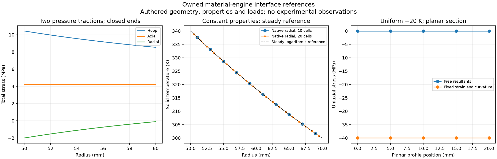

# 재료 엔진의 압력 단면·고체 열 이력 연결

`material_exchange`는 기존 matintegrity 모델을 호출한다. 이쪽은 독립된 탄성/
열전도 계산기를 만들지 않고 모델·버전·스키마·단위·확률 의미·원 입력·자산·
위치·시계·상태와 해시를 확인한다. 계산 성공은 재료값·실제 형상·규격·사용
적합성의 승인이 아니다. 원 needs_data/out_of_scope를 유지한다.

## 설치와 재현

matintegrity와 자료 판독에 필요한 pandas, 수치 비교의 SciPy, 그림의 Matplotlib은
별도 설치한다. 모니터링과 HRA도 원 프로젝트를 사용한다. 검증 스크립트는
외부 소스를 읽기 전용으로 사용하며 각 실행 전후의 소스 트리 해시를 확인한다.

```powershell
python scripts/acquire_data.py --only thermal_rod --workers 1 --maximum-seconds 90
python examples/material_sections.py
python scripts/check_material_sections.py --materials PATH_TO_MAT --monitoring PATH_TO_MONITOR --hra PATH_TO_HRA
python scripts/plot_material_sections.py
```

취득은 이전 해시와 비교한다. 공개 서버가 생성한 ZIP의 해시가 바뀌면 덮어쓰지
말고 파일 목록·원 개별 파일과 권리 조건을 다시 검토한다. 이전 취득 SHA-256을
공급자가 발표한 체크섬으로 표시하지 않는다. 원본·변환 관측은 공개 배포에서 제외한다.

## 스키마를 보존하는 Python 작업 API

```python
from pipeline_integrity.material_exchange import prepare_material_job, evaluate_material_job

job = prepare_material_job(
    model_id,
    parameters,
    context,
    location_id="wall-section",
    evidence_ids=("reviewed-inputs",),
)
receipt = evaluate_material_job(job, context)
receipt.check_integrity()
status = receipt.native.status
values = receipt.native.payload["values"]
```

MaterialJob을 JSON으로 저장할 수 있다. 실행은 원 registry.run_json의 strict JSON
검증을 사용하며 중첩 배열과 bool을 보존한다. 기본 MaterialClient.evaluate는
strict Python 경로를 유지하고 input_mode="json"을 명시해 바꿀 수 있다.
model_id/model_version·입력 스키마 해시·
출력 단위·확률 의미를 원 레지스트리에서 고정한다. prepare는 현재 API를 기록하는
행위이며 공학적 적용성 검토를 대신하지 않는다. 저장한 job을 실행할 때 원 API가
바뀌면 거부하고 새 검토를 요구한다. 사용자가 검토한 입력과 출처 ID를 넣는다.

입력 자료는 원 모델의 정확한 필드명과 SI 기준을 따른다. 원 입력의 기본값
추가와 정수→실수 정규화는 허용하되 제공한 필드·중첩 값·bool을 바꾸지 않는다.
결과의 모델·버전·단위·확률 의미·상태, 물리 위치/시계·시나리오·origin 추적,
원 input_digest와 결과 digest를 확인한다. 해시는 변경 감지이며 전자 서명이나
실험적 진실성의 보증이 아니다.

원 모델이 별도 native context metadata를 요구하면 기존 MaterialClient의
현재 메타데이터 전달 범위부터 확인해야 한다. 범용 job이 모든 원 모델의 추가
조건과 분야별 적용성을 자동 해결하지 않는다. 확장은 PI-X04를 따른다.

## 원통 압력 단면

`PressureSection`에는 asset/location/clock/time, 내외반경과 전체 벽을 포함하는
증가 반경 목록, 내압·외압 각각의 Pressure와 끝단 조건·근거를 넣는다.
`evaluate_pressure_section(request, context)`는 원 mechanics.lame_cylinder를 각
반경에서 호출하고 두 표면의 압축 반경 응력이 입력 압력과 맞는지 확인한다.
압력이 없으면 needs_data이며 원 엔진을 호출하지 않는다.

각 압력은 absolute 또는 명시적 대기압을 가진 gauge여야 한다. 차압 한 개를
두 표면의 압력으로 사용하지 않는다. 게이지 입력은 먼저 절대압으로 바꾼다.
따라서 반환 총응력에는 외부 정수압 성분이 포함된다. 압력을 0으로 바꾸거나
von Mises와 같은 등가응력에 임의의 기준압을 다시 더하지 않는다.

pressure_loaded_closed_ends=True는 두 압력에 의한 끝단 하중을 원 장축 응력으로
받는다. False는 원 모델의 **장축 응력 0** 조건이다. 이를 모든 실제 개방 배관의
끝단·지지·외부 하중 상태와 같다고 가정하지 않는다. 압축성 유동·변형·끝단
효과·노즐·굽힘·소성·외압 좌굴·규격 사용 적합성은 이 계산에 포함되지 않는다.

원 모델의 선형 등방 탄성 가정을 따른다. 내압 우세·외압 우세·압력이 같은
상태와 두 끝단 조건의 실제 호출을 확인했다. 129점의 원주 응력을 적분한 횡단
힘, 장축 힘과 두 경계의 반경 응력을 독립 평형으로 비교했다. equal-pressure
닫힌 끝단은 정수압 응력이며 von Mises는 0이었다. 작은 응력 잔차는 실제 관의
강도·잔여 수명이나 외압 안정성 검증이 아니다.

## 고체 온도 이력과 평면 열응력

이번에 확인한 원 모델은 다음과 같다.

| 원 모델 | 실제 확인 범위 |
|---|---|
| mechanics.lame_cylinder | 전체 벽 반경·내외압·장축 조건·힘 평형 |
| mechanics.plane_stress | 순수 전단의 주응력/등가응력 |
| mechanics.thermal_restraint | 균일 온도 변화의 자유/완전 구속 |
| thermal.planar_layers | 고정 물성 층의 저항·열률 |
| thermal.lumped_temperature | 한 시정수의 온도·Biot 범위 초과 보류 |
| thermal.transient_conduction_1d | 평판/원통 반경·경계/물성·이산 에너지·온도 시계 |
| mechanics.through_wall_thermal_stress | 평면 프로필의 자유/구속·검토 누락·탄성 한계 |

과도 열 모델은 사용자 온도 의존 물성 표·재료/셀·초기 조건·시간·경계·분포 열을
받는다. 출력의 부호 있는 경계 에너지와 원 온도 지원 범위를 유지한다.
`solid_thermal_frames(receipt)`는 computed일 때만 원 출력 시각의 셀 온도를 K,
simulation origin으로 내보낸다. receipt의 셀 위치·입력/결과·시계와 함께 사용한다.

셀 값은 유한체적의 온도 표현이다. 이를 실제 표면 온도, 점 관측 또는 다른
형상의 단면 프로필로 자동 변환하지 않는다. 원통 정상이력은 중심점 로그 기준과
체적 가중 셀 평균 기준을 따로 확인했다. 중심점과의 수치 일치는 약8e-13K 이내지만
실제 셀 평균 기준 오차는 10셀 약0.0152K, 20셀 약0.00388K다. 전자의 작은 오차를
셀 평균의 정확한 해나 일반적인 공간/시간 수렴 증거로 사용하지 않는다.

원 두께 열응력은 단축 또는 등2축 **평면 응력**과 합력/변형 제어 모델이다.
원통의 반경 열응력·평면 변형률과 같지 않다. FVM 셀 중심을 그대로 단면 양 끝
좌표로 쓰면 실제 두께가 줄 수 있고 셀 평균과 점 값도 혼동된다. 이 API는 그런
자동 연결을 제공하지 않는다. 실제 형상/끝점·평면 조건·투영 근거와 보존 기준을
갖춘 별도 검토가 필요하다. 균일 가열 평면 기준은 자유 응력 약0, 완전 구속
약-40MPa였다. 탄성 한계 초과와 검토 누락은 원 상태로 보류했다.

## 무열입력 단열 기준의 발견 사항

현재 소스에서 균일 300K·양쪽 단열·발열0 조건은 온도가 거의 일정했지만
약4.62e-10J의 절대 에너지 잔차와 상대 잔차1로 out_of_scope였다. 분모에 사용할
열이 거의 없을 때 저장량 반올림이 상대 잔차를 지배한다. 이쪽에서 상태를 바꾸거나
허용값을 무작정 늘려 통과시키지 않았다. 원 코드 변경은 하지 않았다.

PI-X04에 부호·단위 있는 에너지 장부, 명시적 절대+상대 판정, 무열·작은 열·상쇄
열·서로 다른 체적/열용량의 실제 인수 검사를 요청했다. 원 상태가 수정되면 같은
입력과 새 소스 해시로 재현하고 기록을 갱신한다. 다른 강제 열/반경 기준의 계산
성공으로 이 실패를 지우지 않는다.

## 공개 봉재 실험의 해석과 적용

[Tomanek·Stutts의 V1 자료](https://doi.org/10.17632/sbcf36976g.1)는 CC-BY-4.0이다.
원 CSV77개·215001행을 기존 thermal_data reader로 읽고 모든 숫자를 원 CSV와
대조했다. 여섯 열은 주변 온도 대비 온도차이고 28161개의 음수 온도차를 보존했다.
제어기 값은 1023 기준 카운트로서 W·열유속으로 바꾸지 않는다. 가공된 fit 결과는
같은 관측에서 추정된 값이며 독립 검증 자료가 아니다.

`thermal_rod_frames(archive, run_id)`는 검토한 ZIP의 해시·크기와 원 member 해시,
run ID를 확인한 뒤 laboratory SignalFrame과 매핑 근거를 반환한다. 원 시각을
정렬·중복 제거·보간하지 않는다. clock_id는 실험과 원 member 해시로 구분한다.
채널 이름의 excess와 별도 매핑의 temperature_basis를 함께 유지한다.

50cu3의1937표본은 기존 모니터링 SignalBatch와 HRA SignalSeries로 전달했다.
HRA의 K 단위만으로 온도차와 절대 온도의 기준이 구분되지는 않는다. 매핑 근거를
동반해야 하며 절대 온도 한계와 자동 비교하거나 HEP를 계산하지 않는다.

같은 run에서 명시한21개 시각/원 행을 골라 TC1+가정한293.15K를 왼쪽 경계로 둔
조건부 고체 열 시나리오를 실행했다. 봉 길이·면적·물성·분포 대류와 센서가 실제
경계라는 가정은 원 설비에서 검증되지 않았다. 원 시각·선택 행을 보존하고 중간
경계에는 원 모델의 시간 보간 정책을 사용한 조건부 재생이다. 실시간 예측은 아니다.
온도 위치가 미확정이라 다른
열전대에 대한 예측 오차를 계산하지 않았고 source_status=needs_data를 유지했다.
이 자료는 관 두께 열응력·구조 건전성의 독립 검증으로 사용하지 않는다.



상세 원/변환 관측·조건부 입력/결과는 artifacts에만 있다. 공개 그림과 수치 기준은
자체 작성한 입력이며 실험 관측을 포함하지 않는다. API·원 소스 해시·16개 단일
모델 사례·4개 압력 단면과 실제 자료 연결은 research/material_sections_results.json을
따른다. 외부 확장 요청은 PI-X04/06, 권리/출처는 DATA와 THIRD_PARTY_NOTICES를 따른다.
