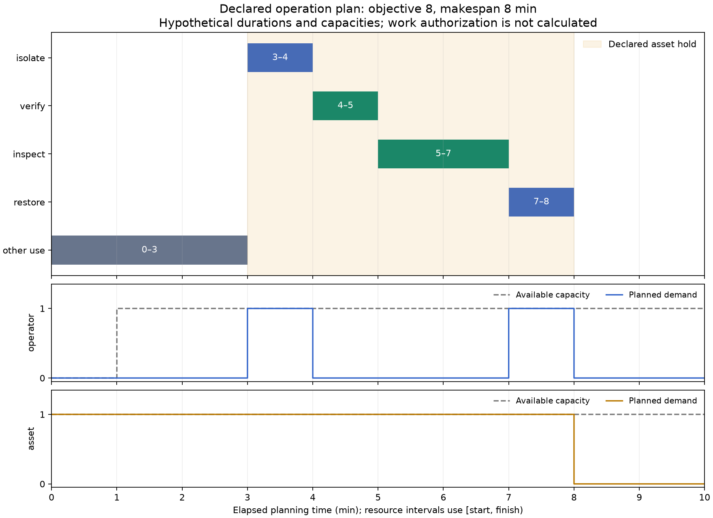

# 운전·정비·검사 작업의 자원 일정

`scheduling`은 선언한 유한 기간에서 모든 필수 작업의 방식·시작·종료를 정한다.
정수 시간 격자의 비선점 작업과 자원 용량·달력·선행 관계·자원 유지·소모품을
OR-Tools CP-SAT으로 푼다. 별도 사건 순회 검사로 반환 일정을 대조한다.
기존 HRA의 작업·정성 분석을 복제하지 않고 원 단계·역할과 계획 해석을 연결한다.

## 설치와 재현

```powershell
python -m pip install -c requirements-tested.txt ".[scheduling]"
python examples/operations_schedule.py --write-job examples/operations_schedule.json
pipeline-integrity schedule examples/operations_schedule.json --output artifacts/scheduling/result.json
python scripts/check_scheduling.py --hra PATH_TO_HRA
python scripts/plot_schedule.py
```

실제 원 HRA 호출에는 별도 프로젝트가 필요하다. 그림에는 figures 의존성이
필요하다. 현재 OR-Tools 9.15.6755, 원 Python 모듈과 CP-SAT 바이너리 해시를
`research/scheduling_results.json`에 보존한다. 공개 원 엔진의 정의는
[공식 일정 문서](https://developers.google.com/optimization/scheduling/job_shop)와
[상태·정수 제약 문서](https://developers.google.com/optimization/cp/cp_solver)를 따른다.
현재 공개 릴리스는 [원 프로젝트 기록](https://github.com/google/or-tools/releases/tag/v9.15)에서 확인했다.
솔버·정성 규칙·현장 표를 소스에 복제하지 않았다.

## 입력 계약

| 객체 | 주요 입력 |
|---|---|
| OperationMode | 방식 ID, 고정 소요 초, 자원·소모품 정수 수량, 고정 비용, 근거 ID |
| Operation | 필수 작업 ID, 대체 방식, earliest_start·latest_finish, due, 완료·지연 비용 |
| PlanningResource | ID·기본 용량, 용량 예외 달력, 근거 |
| TimingRelation | 두 작업과 start/finish 사건, 최소·최대 지연 초 |
| ResourceHold | 지정 사건부터 다른 사건까지 계속 점유할 자원과 수량 |
| ScheduleRequest | 기간·시간 격자·모든 작업/제약·소모품 예산·목적 단위·수치 예산·근거 |
| RunContext | 자산·시나리오·시계·입력 근거 |

모든 Operation은 수행하며 각 작업의 방식은 하나만 고른다. 수행할 작업을
비용 때문에 삭제하는 기능은 없다. 작업 선택·불확실 수명 기반 검사 정책은
별도의 문제다. 소모품은 전체 기간의 정수 사용량, 갱신 자원은 동시에 점유한
정수 수량이다. 수량의 의미와 양자화는 입력 근거에 기록한다.

각 모드의 소요 시간은 고정이며 중간에 끊지 않는다. 교대나 휴식 구간을
건너뛰며 자동 분할하지 않는다. 0초는 자원·소모품을 쓰지 않는 명시적
이정표에만 허용한다. 같은 HRA 역할을 여러 대체 자원으로 해석하려면 해당
인력 자격·수량과 모드의 근거를 검토해야 한다.

달력은 기본 용량을 낮추는 예외 구간이다. 구간 밖에서는 기본 용량을 쓴다.
창은 순서대로 겹치지 않게 제공하며 끝과 다음 시작이 같아도 된다. 자원
구간은 [start, finish)로, 끝난 시각에 자원을 놓고 같은 시각에 다음 작업이
시작할 수 있다. 예외 용량 0은 그 기간 사용할 수 없다는 선언이다.

시각은 context.clock_id의 같은 0점에 대한 경과 초다. 실제 날짜·시간대에서
변환했다면 그 기준도 근거로 남긴다. 기간·작업 시간·달력·기한·지연은
time_quantum_s의 정확한 배수여야 한다. 자동 반올림·보간은 없다. 소수점
문자열의 Decimal 연산으로 격자를 확인하고 시간축은 최대 1e9 tick이다.

## 시간 관계와 자원 유지

TimingRelation은 before/after 작업의 start 또는 finish 사이 차이를 지정한다.
기본은 앞 작업 완료 후 다음 작업 시작이다. 최소 지연과 최대 지연을
동시에 줄 수 있다. start-start·finish-finish도 같은 계약으로 표현한다.
기한이나 제약이 모순되면 유효 모델의 불가능 판정을 받을 수 있다.

ResourceHold는 작업 사이 빈 시간에도 자원을 점유한다. 예를 들어 차단 명령
시작부터 복구 명령 완료까지 asset을 점유하게 해 다른 사용과 겹치지 않게
표현한다. 이는 선언한 일정 충돌 규칙이다. 실제 차단 상태·잔류 압력·작업
허가를 검사한 것이 아니다. 작업 자체와 hold에 같은 자원을 중복 입력하면
둘 다 사용량에 더해지므로 의도한 점유 의미를 검토한다.

## 목적함수와 최적성

목적은 다음 합이다. 시간 비용 계수는 초가 아닌 tick당 정수 비용이다.
objective_unit과 계수의 공통 기준을 선언해야 하며 통화 변환은 수행하지 않는다.

- 최대 종료 tick × makespan_cost_per_tick.
- 각 작업의 종료 tick × completion_cost_per_tick.
- max(0, 종료 tick−due tick) × tardiness_cost_per_tick.
- 선택한 모드의 fixed_cost.

latest_finish는 hard 제약이고 due는 비용에 쓰는 soft 시각이다. 모든 계수와
고정 비용은 음이 아닌 정수다. 최악 목적 상한은 2^50 이하로 제한해 원
부동소수점 보고값에서도 정수 목적을 정확히 대조한다. 목적이 모두 0이면
실행 가능한 어떤 일정도 같은 목적값이며 최단 완료를 주장할 수 없다.
시간 격자를 바꾸면 tick당 비용의 해석도 검토해야 한다.

| 반환 상태 | 의미 |
|---|---|
| optimal | 일정 재검사 통과, 원 하한의 올림과 정수 목적값이 같아 선언 문제의 최적성이 증명됨 |
| feasible | 일정 재검사 통과, 최적성 증명은 남음 |
| infeasible | 원 솔버가 선언한 유한 모델의 불가능을 판정 |
| unknown | 제한 내 실행 가능성·불가능성을 결정하지 못함 |
| withheld | 원 모델 오류·부적합 일정·목적/하한 불일치 등으로 사용 보류 |

원 솔버는 허용 격차에 도달해도 OPTIMAL을 줄 수 있다. 원 이름만으로 정확한
최적성을 표시하지 않는다. 실제 격차 종료 사례는 목적 9·하한 7·원 OPTIMAL을
반환했고, 이 API는 feasible로 분류했다. 충분히 푼 기준은 목적 8이었다.
최적성은 입력한 비용과 제약에 한정되며 위험·HEP의 최소화나 작업 허가가 아니다.

## 독립 검사와 확장 API

감사기는 생성한 솔버 제약 객체를 읽지 않고 원 입력과 선택 모드·tick에서
작업 ID·시간·기간·hard 창·관계·hold·소모품을 다시 계산한다. 자원은 작업과
hold의 시작/끝 및 달력 변경 사건을 합쳐 순회한다. 같은 시각의 변경을
함께 적용해 접경 시각의 가짜 초과를 만들지 않는다. 목적도 다시 계산한다.
부적합 primal이나 잘못된 하한은 timeline으로 전달하지 않는다.

Python은 `solve_schedule(request, context)`, 별도 감사는 `audit_schedule`을 쓴다.
다른 솔버는 solve(request)→ScheduleCandidate 계약을 제공한다. 원 후보의
사양 해시·상태·배정·목적·하한·실행 환경을 보존해야 한다. 타 솔버의 하한
자체는 그 공급자의 증거이며 이 감사기는 primal을 독립 검사한다.
최대 작업·interval 수와 검색 시간을 입력한다. 검색 시간은 Python의 모델
구축·감사 시간을 포함한 전체 프로세스 제한이 아니다. 기본 단일 worker와
seed를 기록한다. runtime이 달라 전체 receipt 해시가 달라질 수 있다.

입력 인스턴스는 원 Python 타입을 보존해 재검증한다. model_copy로 숫자를
boolean으로 바꾼 객체가 JSON 직렬화 과정에서 1로 정규화되는 문제를 검사하고
차단했다. JSON 입력도 엄격한 계약을 따른다. result.check_integrity()로
수정된 중첩 값과 원 후보를 확인한다. 해시는 진위나 현장 적합성의 인증이 아니다.

## HRA 작업 연결

schedule_exchange.bind_hra_task에는 원 Task, 일정 입력·문맥, 모든 단계의
step_to_operation과 역할별 actor_to_resource, 해석 근거를 제공한다. 원
Task 검증·ordered_steps를 재사용한다. 각 방식이 대응 역할 자원을 예약하고
원 선행 관계를 명시적 finish-start 관계로 포함하는지 확인한다.

원 TaskStep.deadline_s는 같은 일정 0점의 최종 완료 시각인지, 신호 후 주어진
시간인지 알 수 없다. 자동 적용하지 않고 unapplied_deadlines_s로 보존한다.
계획의 latest_finish는 사용자가 별도로 선언한다. 원 전제·잠재 위험·역할·
단계 설명도 원 snapshot에 유지한다. 계획이 전제 충족을 검증하지는 않는다.

planned_hra_steps는 감사가 통과한 feasible/optimal 일정만 받는다. 같은 문맥·
사양·binding 해시를 확인하고 planned_elapsed_seconds·simulation으로 반환한다.
observed_completion·physical_isolation_verified·task_preconditions_verified와
work_authorized는 거짓이고 human_failure_probability는 None이다. 원 HRA
analyze_task의 검토 후보를 변경하거나 소요 시간에서 오류 확률을 만들지 않는다.
원 HRA에 계획 시각을 저장하는 표준 필드가 없어 receipt를 별도로 보존하며
PI-X06에 시계·기한·계획/관측·역할 자원의 수용을 요청했다.

## 실제 실행과 공개 자료 적용

원 작성 기준은 5작업·3자원·대체 방식·1소모품·1hold다. 느린 검사 방식으로
8분·목적 8이 나왔고 빠른 방식 고정비용을 0으로 바꾸면 7분이었다. 소모품
부족·교대 지연·hold 제거·불가능 기한·검색 한계·0시간 비용도 따로 실행했다.
HRA는 실제 4단계·정성 후보 5개·실패 사건 정의를 호출했다. 정량 실패확률은 없다.



GasLib의 기존 원본에서 8개 관의 ID와 연결 노드를 읽고 각 관의 가상 작업을
만들었다. 실제 정비 시간·인력·차단 조건을 추정한 것이 아니다. 1개 crew로
600초 또는 2개로 300초, 첫 600초는 crew 1개·이후 2개, 공유 노드의 동시
작업 금지를 선언했다. 총 crew 작업량 4800초에서 하한 2700초가 나오며 실제
일정이 이를 달성했다. 원 열역학·능동 장치가 미매핑인 상태는 그대로다.

GasLib의 CC BY 3.0·Schmidt 등의 DOI 10.3390/data2040040·원 요구 인용인
Pfetsch 등의 ZIB Report 12-41(2012)과 해시를 보존한다. 원 XML·변환 표·
전체 배정은 로컬 artifacts에 두고 공개 요약에는 집계와 재현을 남긴다.
수치 비교·작은 문제의 독립 완전 탐색·자원 감사가 현장 일정 검증을 대신하지 않는다.

새 연구자는 입력 근거·시간 기준·작업 자격·실제 달력·현장 허가와 물리 상태를
확인한다. 불확실한 소요 시간·실시간 재계획·실제 명령/완료·동적 위험 연계는
별도 후속 연구다. 해당 기능을 이 일정 모듈의 완료 범위로 집계하지 않는다.

## 모드마다 다른 실행 창

OperationMode.earliest_start_s / latest_finish_s는 기본 None이며 선택된 모드에만
적용한다. 작업 전체의 창과 교집합을 이루고 시간 격자·기간 밖·역전된 경계는
거부한다. 창보다 긴 선택은 실행 불가능한 모드로 남아 다른 모드와 비교된다.
공유 CP-SAT의 조건부 제약과 독립 audit_schedule이 같은 원 입력을 검사한다.
INSPECTION_PLANNING의 예약 메뉴는 이 기능을 재사용한다. 기존 9개 실제 일정
사례와 HRA/형상 연결을 새 소스 해시로 다시 실행했고 원 모드의 의미를 유지했다.
