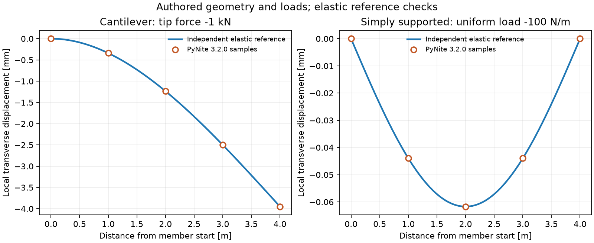

# 선형 탄성 배관 프레임

`pipeline_integrity.structural`은 노드·명시적 직선 부재·단면·재료·지지·하중을
선택 설치한 PyNite 3.2.0에 전달한다. 변위·회전·반력·부재력과 실행 근거를
반환한다. 유한요소 강성 엔진을 복제하지 않고 별도 배포 패키지를 호출한다.
`structural.beam_network`는 부분 구현이다. 일반 배관 응력 설계의 완료가 아니다.

균일 축 초기변형률·재료 엔진의 열팽창·직선 원통의 압력/Poisson 입력과
복원 부재력·노드별 힘 수지는 [FRAME_LOADING_KO](FRAME_LOADING_KO.md)를 따른다.
기존 axial_n은 원 엔진의 보정 전 값이며 초기변형률이 있을 때는 구분해 읽는다.

## 설치와 첫 실행

```powershell
python -m pip install -c requirements-tested.txt ".[structural]"
python examples/pipe_frame.py
```

예제는 외경 0.20m·내경 0.18m·길이 4m의 선언한 환형 단면에 임의의 탄성
물성과 -1000N 끝 하중을 적용한다. 상용 관종·규격의 허용값을 가져오지 않았다.
지지점의 FY 반력은 약 +1000N, MZ 반력은 약 +4000N·m이고 끝 DY는 약
-0.00394918m다. 이 값은 작성한 선형 기준 문제의 결과다.

```python
from pipeline_integrity.structural import FrameRequest, solve_frame, frame_signal_frame

# payload는 API 스키마에 맞춘 JSON 문자열, context는 RunContext다.
request = FrameRequest.model_validate_json(payload)
receipt = solve_frame(request, context)
signal = frame_signal_frame(receipt, "service", context)
```

`examples/pipe_frame.py`의 `make_case()`·`context()`는 Python 객체로 직접
확장하는 예다. 직렬화 입력은 `model_validate_json`, Python 입력은 엄격한
`model_validate`를 사용한다. 숫자 위치의 boolean·NaN·무한대·추가 키를 거부한다.

## 입력과 좌표

| 계약 | 의미 |
|---|---|
| FrameNode | 사용자가 선언한 직교 Cartesian 좌표[m]와 노드 ID |
| FrameSection | A[m²], Iy·Iz·비틀림 상수 J[m⁴], 근거 ID |
| FrameMaterial | E[Pa], 등방성 ν, 근거 ID. G는 E/[2(1+ν)] |
| FrameMember | i→j 방향, 단면/재료 ID, 로컬 x 주위 회전[degree], 회전 해제, 샘플 위치 |
| FrameSupport | 고정 자유도, 양방향 병진 스프링[N/m]·회전 스프링[N·m/rad], 강제 변위·회전 |
| FrameNodeLoad | 전역 FX/FY/FZ[N] 또는 MX/MY/MZ[N·m], signed 값 또는 None |
| FrameLineLoad | 전역 힘 방향의 선형 분포[N/m], 명시한 부재 구간과 하중 경우 |
| FrameCombination | 선언한 하중 경우의 사용자 계수. 규격 조합을 내장하지 않음 |
| FrameInitialStrain | 선언한 균일 무응력 축변형률, 경우·근거·signed 값/None·적용 검토 |
| FrameRequest | 자산·시계·시각, 전체 위 계약과 적용 검토, 수지/변위 한계 |

좌표는 지리 경위도를 자동 변환하지 않는다. 서로 다른 노드를 같은 위치에
두거나 사용하지 않는 노드, 없는 단면/재료/하중 경우를 거부한다. 분기점이
부재 내부에 있으면 먼저 부재를 나눠야 한다. 교차한 선을 자동 접합하지
않으며 연결 관계의 검토 책임은 입력에 남는다. 원 엔진의 내부 자동 분할이
요청과 다르면 결과를 보류한다.

`annular_frame_section(id, outer_diameter_m, inner_diameter_m, evidence_id)`는
동심 원형 단면의 면적·탄성 단면 2차 모멘트·Saint-Venant 비틀림 상수를
기하에서 구한다. 다른 단면은 FrameSection으로 직접 제공한다. 부식·타원화·
굽힘부 유연성·응력 집중을 이 상수에 자동 반영하지 않는다.

고정과 스프링은 같은 노드 자유도에서 겹칠 수 없다. 강제 변위·회전은 고정한
자유도에만 선언한다. 지점 이동은 요청 전체에 적용하므로 하중 조합 계수 0도
이동을 0으로 바꾸지 않는다. 이동을 별도로 바꾸려면 다른 요청을 만든다.
Ry/Rz의 i/j 회전 해제를 지원한다. 해제 부재의 끝 회전과 연결 노드 회전은
같다고 가정할 수 없다. 축·전단·비틀림 해제와 단방향 접촉은 현재 입력 밖이다.

## 계산과 보류

자산·시계·모든 근거 ID를 확인하고 형상/연결·강성/하중·지지·선형 소변위
적용의 네 검토가 모두 참일 때 엔진을 호출한다. 미검토나 알 수 없는 집중
하중 None은 needs_data다. 원 엔진이 없으면 필요한 structural 설치를 명시하는
ImportError를 발생시킨다. 이 어댑터에서 실행을 검토한 버전은 3.2.0이다.

선형 소변위·탄성·전단 변형을 무시하는 부재를 계산한다. PyNite의 다른
해석 종류를 자동 선택하지 않는다. 중량도 자동 적용하지 않는다. 관·유체·
보온·부속물의 검토한 선중량을 명시적 전역 분포하중으로 제공한다. 압력
추력과 열 고유변형률도 자동 적용하지 않는다. 엘보·티·벨로즈·지지 간극·
마찰·압축 전용 접촉·지반·항복·P-Δ·좌굴·동역학·피로 자격은 후속 범위다.

결과에는 다음 수치 검사를 남긴다.

- 별도 적분한 전역 하중과 모든 반력의 힘 수지, 지정 원점 주위 모멘트 수지.
- 힘과 모멘트를 서로 다른 단위·절대+상대 허용값으로 판정한 결과.
- 최소 부재 길이에 대한 노드 변위, 각 부재 길이에 대한 샘플 변위, 노드 회전.
- 원 엔진의 좌표 기저·버전·Python 소스 해시·경고·불안정 진단.

부재 분포하중의 전역 합력과 1차 모멘트는 요청의 구간과 선형 강도에서
독립 적분한다. 부재 내부의 native equivalent force vector를 수지 정답으로
재사용하지 않는다. 지점 이동·양방향 스프링의 반력도 포함한다. 기본 허용값은
힘 1e-6N, 모멘트 1e-6N·m, 상대 1e-8이다. 작은 하중을 임의의 1N으로 정규화하지 않는다.

기본 변위/길이 한계는 0.05, 노드 회전 한계는 0.05rad다. 사용자가 검토한
값으로 변경할 수 있으나 규격 허용값이나 물리적 안전 보증은 아니다. 샘플링한
처짐 한계는 연속 곡선 전체의 최대값 보증이 아니다. 큰 강체 이동도 절대 변위
검사에서 보류될 수 있다. 수지 또는 선언한 적용 한계를 넘으면 계산 원값을
남기고 out_of_scope로 표시한다. 특이·불안정 모델도 out_of_scope며 지지를
추가해 임의 복구하지 않는다.

## 부재력과 신호

각 조합은 별도 결과다. 노드 결과는 전역 변위[m]·회전[rad]·반력[N]·반력
모멘트[N·m]다. 부재의 global_to_local은 로컬 기저를 행으로 둔 3×3 변환이다.
native_local_end_actions와 native_global_end_actions는 원 엔진의 i/j 끝 6성분씩
[Fx,Fy,Fz,Mx,My,Mz] 순서다. 단면 샘플의 axial/shear/torque/moment는 원 엔진의
내력 부호를 그대로 유지한다. 끝 작용과 단면 내력을 무조건 같은 부호로 보지
않는다. 스칼라 von Mises나 파괴·파손 확률로 자동 변환하지 않는다.

frame_signal_frame은 지정 조합의 노드 채널을 SignalFrame으로 만든다. 조합별
stream_id를 달리하고 한 시각의 서로 다른 하중 조합을 시간 이력으로 연결하지
않는다. 출력 origin은 항상 simulation이다. 미계산 채널은 None/invalid,
범위 밖에서 계산된 원값은 값/invalid로 유지한다. 이후 기존 monitoring_batch와
hra_signal_series를 직접 사용할 수 있다. 전달이 HEP 학습·보정·현장 위험 검증은 아니다.

## 공개 하중 자료의 적용

`FrameSignalLoad`와 `solve_frame_signal_snapshot`은 한 신호 채널을 지정한
집중하중 슬롯에 대입한다. 스트림·채널·근거·시계를 확인하고 N 또는 N·m로
차원 일치 변환한다. 음수·0·원 시각을 보존하고, 결측/invalid는 하중 None으로
전달한다. 변환 대상은 힘/모멘트이며 압력이나 변위를 하중으로 추정하지 않는다.
준정적 snapshot 가정의 검토는 기본 False다. False이면 엔진 호출 없이 보류한다.

실행 연구는 Gao의 CC-BY-4.0 C1/C2 원시 시험 중 한 시편 4631행을 읽고 처음
32행의 signed force_N을 가정한 환형 외팔보의 축하중에 대입했다. 원 하중
32개·24출력 채널과 시계를 실제 모니터링/HRA 클래스에 전달했다. 실제 시험의
치구 형상·동적 하중 해석은 미확정이다. 이 결과는 선언한 정적 프레임의
하중 전달 실험이며 원 시험의 구조 응답·균열 정지 성능 검증이 아니다.
원 관측과 상세 대입 결과는 artifacts/structural에만 보관한다.

## 재현과 근거

```powershell
python -m pytest tests/test_structural.py -q
python scripts/check_structural.py --materials PATH_TO_MAT --monitoring PATH_TO_MONITOR --hra PATH_TO_HRA
python scripts/plot_structural.py
```

25개 검사는 해석해·3D 회전·단면 회전·분기 중첩과 Maxwell-Betti 상반성·
두 부재 분할·회전 해제·스프링·지점 이동·누락/무효 신호·엄격한 타입·근거·
시계·결과 변경·범위 보류를 확인한다. 별도 실행은 작성한 14사례, 8개 수치
기준, 원 하중 32snapshot과 실제 소유 신호 클래스를 기록한다.



원 엔진과 이용 조건은 [PyNite 공식 저장소](https://github.com/JWock82/Pynite),
[부재 문서](https://pynite.readthedocs.io/en/latest/member.html),
[해석 문서](https://pynite.readthedocs.io/en/latest/analysis.html),
[MIT 라이선스](https://github.com/JWock82/Pynite/blob/main/LICENSE)에서 확인했다.
수치와 그림은 별도 작성한 기하·하중과 독립 탄성 기준식으로 만들었다.
원 시험 출처는 [Gao, Mendeley V1](https://data.mendeley.com/datasets/g69875w65c/1)이다.
파일·단위·시편·원 시계 검토는 FRACTURE_EXCHANGE를 함께 읽는다.

## 공개 native 조립·감사 API v1

`build_native_frame(specification, context)`는 기존의 유일한 native 모델 구성 경로이다. 기존 `solve_frame`도 이 함수를 사용하며 외부 어댑터에서 동일 geometry/material/support/load 조립을 복제할 필요가 없다. 반환하는 `NativeFrameAssembly`는 요청·문맥·native 모델 handle과 `pipeline_integrity.frame_assembly.v1` 영수증을 가진다. 검토 또는 하중이 미상이면 native import 없이 needs_data와 model=None을 반환한다. 기존 분포하중·release·초기변형·부과 지지변위 등 정적 기능은 factory에서도 유지한다.

영수증은 선언 DOF 순서, 고정 DOF index, m/rad 및 N/N·m의 conjugate 단위, 지지·spring·부과변위, 요청/실제 native load case, 재료·단면·원 native 입력 snapshot과 digest, 실제 PyNite source-tree 및 소유 소스 지문을 보존한다. `assembly.check_integrity()`는 영수증/요청/문맥·소유 소스와 native 모델의 입력 변경을 대조한다. native handle은 같은 프로세스에서만 사용하고, 결과 상태/번호 갱신을 제외한 입력을 몰래 변경하지 않는다. native 입력 변경 시 새 요청으로 다시 구성한다. 무서명 digest는 실행 신원을 인증하지 않는다.

`audit_frame_equilibrium(specification, combination_id, reactions, context, member_results=None)`는 native 계산 없이 기존 전역 및 선택적 절점 수지를 그대로 수행한다. 모든 절점의 6개 반력 성분은 FX/FY/FZ/MX/MY/MZ 순서이다. 부재 결과를 공급할 때는 모든 명시 부재의 12개 `initial_strain_adjusted_global_end_actions`가 필요하다. 반환하는 `pipeline_integrity.frame_equilibrium_audit.v1`은 `static_balance`, `nodal_balance`, passed, 단위/문맥 및 입력/source digest를 포함한다. 감사 통과는 공급 반력이 수지를 맞춘다는 의미이며 그 반력이 native 해라는 독립 증거는 아니다. soil-pipe 변환은 이 API를 통해 등가 외력을 제거한 물리 반력을 감사한다.

`assemble_frame_stiffness(assembly, combination_id, reference_record=..., include_geometric=True, maximum_full_dofs=600, absolute_translation_tolerance_m=1e-10, absolute_rotation_tolerance_rad=1e-10)`는 동일 factory로 구성한 현재 소유자의 computed 기준 영수증을 요구한다. native reference 상태를 다시 계산하고 변위 및 축력을 대조한 뒤 `pipeline_integrity.frame_stiffness_assembly.v1`을 반환한다. 실제 native 번호가 선언된 DOF/support와 일치하는지 확인하고 Ke/Kg와 각 digest, 기준 영수증 digest, native/소유 sourcepin 및 prestress audit를 보존한다. sourcepin이나 모델 입력이 바뀐 기준 영수증은 거부한다.

Ke만 요청하는 `include_geometric=False`는 기존 정적 factory의 기능을 유지한다. 검토된 Kg 경로는 기존 buckling adapter와 같은 nodal-load/무 initial-strain/무 release/homogeneous-support 범위이다. 이 제한을 일반 정적 프레임 기능에 적용하지 않는다. Kg는 native `first_step=False`를 사용하고 보존 패턴은 Ke+λKg이다. 고유값 solver는 이 API에 포함하지 않는다. buckling adapter가 SciPy 일반화 고유값 solver를 사용한다.

기존 `solve_frame` 결과의 키·부호·수치 허용오차·정적 장부는 유지하며 `backend.assembly_record`와 조합별 `equilibrium_audit_record`를 추가한다. 이 refactor의 native 입력 변경 검출, 미상 요청의 no-import, 독립 정역학 감사 및 행렬 영수증 회귀 시험을 작성했다. Ruff와 Python 컴파일을 확인했으며 사용자 지시에 따라 pytest/native/수치 실행은 하지 않았다. 검증 완료로 표시하지 말고 후속 누리온 환경에서 기존 구조·soil-pipe·buckling 시험을 함께 실행한다.
