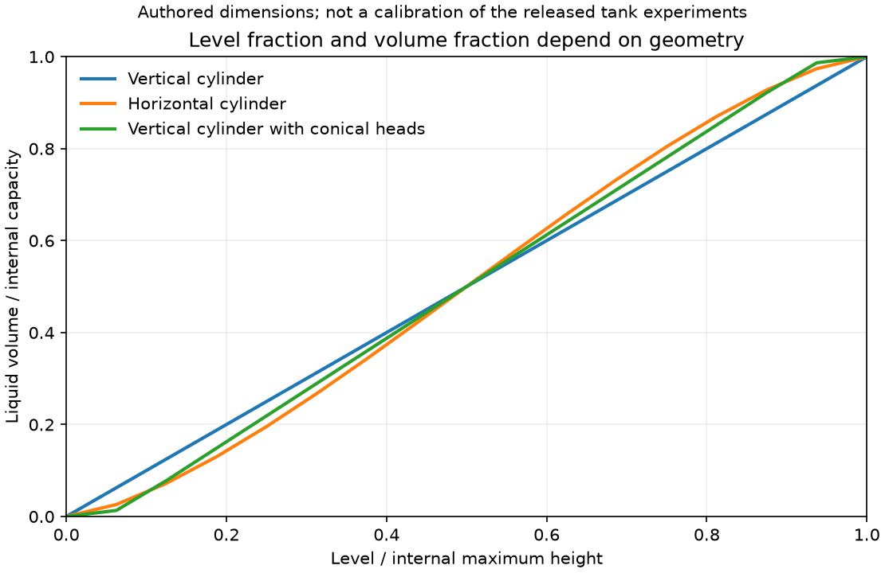

# 탱크 액위·체적·정적 재고

`pipeline_integrity.tanks`는 내부 형상 또는 검토한 보정표, 액위/액체 체적 관측,
선언한 균일 밀도 또는 기존 물성 공급자를 연결한다. 형상 계산에는 별도 설치한
Fluids의 TANK를, 상태 물성에는 기존 CheckedProvider/CoolPropProvider를 재사용한다.
탱크 동역학·층상 열전달·기액 평형을 새로 구현하지 않는다. 기존 수소 탱크 엔진은
그 책임을 유지한다. 이 기능은 정적 재고 스냅샷이다.

## 실행과 Python API

```powershell
python -m pip install ".[engineering,thermo,figures]"
python examples/tank_inventory.py
python scripts/acquire_data.py --only coupled_tank --workers 2 --maximum-seconds 90
python scripts/check_tank_inventory.py --lh2dt PATH_TO_LH2DT --monitoring PATH_TO_MONITOR
python scripts/plot_tank_inventory.py
```

```python
from pipeline_integrity.tanks import evaluate_tank_inventory

result = evaluate_tank_inventory(request, context)
if result["status"] == "computed":
    liquid_volume = result["values"]["liquid_volume_m3"]
if result["mass_status"] == "computed":
    total_fluid_mass = result["values"]["total_fluid_mass_kg"]
```

전체 실행 입력은 examples/tank_inventory.py에 있다. 원 형상·모니터링 프로젝트는
별도 설치하거나 검증 스크립트에 위치를 지정한다. 공급자/보정표의 근거를
RunContext에 넣는다. 관측 tank_id와 clock_id는 context와 일치해야 한다.

## 형상과 관측

| 계약 | 입력과 의미 |
|---|---|
| AxisymmetricTank | 내부 직경, 직선 몸통 길이, 수평/수직, 각 끝단 형상, 근거 |
| TankHead | flat/conical/ellipsoidal/spherical/torispherical/guppy와 명시적 깊이 또는 반경 비 |
| CalibratedTankCurve | 내부 바닥 기준 높이(m)·액체 체적(m³)의 검토한 단조 보정표 |
| TankObservation | 설비·시계·경과 초·내부 바닥 기준 액위 또는 액체 체적·SI 단위·valid·근거 |
| TankInventoryRequest | 형상, 관측, 선택적 액상/기상 밀도, 역변환 방법과 잔차 허용값 |

끝단 깊이는 몸통 길이에 포함하지 않는다. 토리구면의 dish/knuckle 비는 반드시
공급하고 제조사나 규격 기본값을 자동 적용하지 않는다. flat에 불필요한 깊이,
정의가 미완성인 헤드, 직경 외곽을 벗어나는 깊은 구면 캡은 거부한다. 현재
백엔드에서 수직 guppy는 검증 범위 밖이라 거부한다. 필요하면 별도의 검토한
보정표를 사용한다. 형상 입력은 규격 적합성이나 용기 강도를 증명하지 않는다.

보정표의 높이와 체적은 모두 0에서 시작하고 엄격히 증가해야 한다. 순서를
고치거나 중복점을 평균내지 않는다. 구간별 선형 보간/역보간을 사용하며 범위
밖을 외삽하지 않는다. 보정표 계산과 선언 밀도 계산은 핵심 의존성만으로 가능하다.
실제 형상은 engineering, 실제 물성은 thermo 선택 의존성이 필요하다.



## 변환 검증과 상태

Fluids의 full 체적 함수와 기본 brenth 역변환을 호출한다. spline도 명시적으로
선택할 수 있으나 같은 잔차 검사를 통과해야 한다. 형상 17점에서 끝점·범위·단조성을
확인하고 요청한 관측에서 높이/체적 왕복 잔차를 검사한다. geometry_checks에는
오차와 허용값을 남긴다. 허용값을 초과하면 withheld이며 계산값을 승인하지 않는다.

알려진 정확한 높이 0/최대 높이는 각각 체적 0/내부 용량으로 표현한다. 원 함수의
경계 체적도 남기고 잔차를 검사한다. 이는 원 부동소수점 끝점의 단위 반올림 문제를
처리하는 명시적 경계이며, 경계 근처의 임의 관측을 끝점으로 이동하지 않는다.
음수·용량 초과 값은 out_of_scope이며 잘라 맞추지 않는다. 결측/invalid 관측은
needs_data로 남기고 선택 형상 라이브러리를 호출하지 않는다.

status는 기하 계산의 상태다. mass_status는 전체 유체 질량이 계산됐는지 별도
표시한다. 체적을 알아도 밀도가 없으면 질량은 null이다. 양의 상부 공간의 질량을
0으로 가정하지 않는다. 해당 상의 체적이 정확히 0이면 그 상 질량만 0이다.

## 물성과 질량의 의미

DeclaredTankDensity에는 유체·상·균일 밀도와 그 기준/근거를 넣는다.
PropertyTankDensity에는 기존 StateRequest와 근거를 넣는다. P는 절대 Pa,
T는 K이며 나머지 상태 변수도 기존 물성 계약의 SI 정의를 따른다. 반환한 상태의
유체·백엔드·입력 상태 일치와 phase를 확인한다. 액체/액체 유사 상태와 기체/기체
유사 상태를 구분하고 일반 supercritical 상태를 임의로 액상/기상에 배정하지 않는다.

포화 수소 등은 single_phase_required=False와 Q=0/1을 명시한 두 끝점으로 받을 수
있다. 중간 Q의 혼합 밀도를 액상 또는 기상 밀도로 쓰지 않는다. 공급한 균일 밀도를
각 체적에 곱하며, 온도·압력·질량의 시간 변화나 두 상의 평형을 풀지 않는다. 배관의
공간 분포, 정수압 밀도 변화, 용기 벽 질량, 비등·증발·통기·열전달은 여기서 계산하지
않는다. 별도의 기존 물리 모델로 연결한다. 서로 다른 상 상태의 물성이 주어졌다는
사실만으로 기계적/열적 평형이 검증된 것은 아니다.

## 기존 수소 모듈의 형상 연결

`lh2dt_tank_geometry`는 수평 탱크의 동일한 flat 또는 ellipsoidal 양 끝단을 기존
HorizontalVesselGeometry로 전달한다. 두 구현의 용량과 17개 높이의 체적을 비교한다.
반환은 원 geometry 객체와 입력·버전/소스·체적 오차 기록이다. 이번 실제 호출에서
flat 오차는 0, 타원 헤드의 최대 차이는 약 3.48×10⁻⁷m³였다. 부피 형상만 비교했으며
젖은 면적·열전달·동역학의 검증으로 확대하지 않는다. 객체를 변경하면 이 기록을
새 형상의 검증으로 재사용하지 않는다. 수직·비대칭·다른 헤드는 원 수소 API의 확장이
필요해 거부한다. 소유 geometry/DPT·층상 탱크 엔진을 이쪽에 복제하지 않는다.

## 공개 탱크 자료의 실제 상태

[공급자 자료](https://zenodo.org/records/19856119)는 Guilherme Silva, Marcela Coelho,
Valter Leite의 실험 자료(v1.0.0, CC BY 4.0)다. 6개 파일 286911바이트를 공급자 MD5와
대조했다. 전체/변환 관측과 원 설명 문장은 공개 코드 배포에서 제외한다.

원 h1/h2는 각각 81행·10실험 열이며 U는 설명과 달리 80행이다. 전체 수집 표는
4502행이지만 반복 실험의 구간 경계를 자동 추정하지 않는다. 반복 표의 t_ref는
약 4초 간격에 작은 변동이 있어 원 시각을 유지한다. 마지막 액위의 펌프 명령은
미관측이며 채우지 않는다. 명령의 %를 실제 체적 유량으로 바꾸지 않는다.

운영점 JSON은 잘려 읽을 수 없고 내부 h3/h4 키에 mm 표기가 있다. README는 h1/h2를
cm로 설명한다. 두 키 집합과 단위의 관계, 실제 액위 영점, 내부 직경/높이·물성의
추가 근거가 필요하다. 200L의 명목 용량만으로 액위→체적 관계를 확정할 수 없다.
따라서 기본 source_status는 needs_data이며 깨진 JSON을 고치지 않는다.

`tank_data.CoupledTankReadRequest`로 run_number·cm/mm 선택·바닥 영점 보정·각 근거·
취득 origin을 명시하면 SignalFrame을 만들 수 있다. 원 10개 열에 서로 다른 상대
실험 clock_id를 준다. 공통 절대 시계라고 가정하지 않는다. 출판사 체크섬, 원 행·
단위 매핑·소스 해시와 결측을 보존하고, 원 자료로 검증되지 않은 새 파일의 origin은
호출자가 명시한다. 원본 파일을 simulation으로 다시 표시하지 않는다.

실제 1620개 액위 관측에 cm·영점 0·내경 0.4/0.6m·동일 용량 0.2m³ 및 균일 물
상태를 가정해 3240개 조건부 스냅샷을 계산했다. 이 가정들은 실제 설비 교정이
아니다. mm 선택은 이 수직 원통 가정에서 체적이 10배 달라진다. 원 자료의 단위
문제를 이를 이용해 결정하지 않는다. 기체 밀도는 미제공이므로 전체 질량은 null이다.

실험 1의 81×3 SignalBatch는 기존 모니터링 API로 실제 전달했다. 마지막 펌프 명령의
NaN/valid=False와 metadata의 clock_id를 유지했다. 검출 정확도나 실제 질량 수지를
검증했다는 뜻이 아니다. 원본 해시·실험 열·매핑 receipt와 각 가정은 로컬 기록에 남는다.

## 검증과 이어가기

기하·물성·원자료 계약 검사 및 실제 18개 가정 사례는
research/tank_inventory_results.json과 VERIFICATION을 따른다. 공개 그림은 원 실험
관측을 포함하지 않은 독립 작성한 형상 기준이다. 자료가 생기면 단위·영점·형상·
유량·압력·온도 근거를 먼저 맞추고 PI-X01의 일반 geometry/탱크 교환 계약으로
연결한다. 호흡·장기 재고 동역학은 별도 범위다.

채택한 [Fluids의 형상 API](https://fluids.readthedocs.io/fluids.geometry.html)는 1.3.1을
실행했고 설치 메타데이터의 MIT 조건을 확인했다(2026-10-27). 원 계수표·규격 문장·
공급자 제작 기준을 가져오지 않았다. 물성 공급자와 사용자 보정표를 교체할 수 있다.
