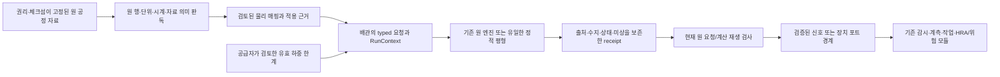

# 인양·압축·상변화와 공정 자료의 인수인계

2026년 10월 28일 단계다. 전체201개 중 구현36·인터페이스 확인99,
**135/201(67.2%)**다. 부분21·계획16·현장 절차29는 분자에 포함하지 않는다.
등록 계산24개 외에 독립적으로 조합할 수 있는 서비스 경계를 추가했다.
전체 pytest2403개·실패/생략0, JUnit394.540초다. 기존 FiPy upstream 경고2건은
원 로그에 보존했다. 이 지표는 같은 가중치의 기술 범위이며 공수/기간/현장 자격 완료율이 아니다.

## 이번에 구현한 연결

| 서비스 | 구현/재사용 | 완료와 남은 경계 |
|---|---|---|
| 인양 하중 | NumPy 선형해석, 원 힘/모멘트·공유 부품 합력·검토된 유효 한계 | 고정 강체 자세의 유일한 장력 검토 구현; 초정정/변형/안정성/동역학·실제 공급자/현장 자격 별도 |
| 다단 압축 | 기존 LH2DT 압축점·CoolProp, SciPy 맵 보간·명시 냉각/손실 예산 | H2/ParaH2 총상태 맵 경계 실제 확인; 서지/제어/로터·독립 맵 검증은 부분 |
| 상변화·단열 | 기존 계면·정상/동적 장치·진공 단열6종 signature | 원 부호·상/포트·endpoint 수지 보존; 벌크 고화/frost·전체 열린 step 적분 장부는 부분 |
| 실제 자료 | 권리/원본 pin·streaming/단위/미상 판독 | DCS35036×25, 처리 LN2 89행; 맵/독립 H2 truth와 원 압력/온도 전체 행·NASA OCR 수치 자격은 아님 |

정확한 필드·API·예제는 [인양](LIFTING_KO.md), [압축기](COMPRESSOR_TRAIN_KO.md),
[상변화](PHASE_CHANGE_KO.md), [자료](THERMAL_PROCESS_DATA_KO.md)를 따른다.
새 물리 solver·성능 표를 복제하지 않았고 원 소유 엔진/라이브러리는 수정하지 않았다.



이 그림의 매핑에는 명시한 입력/근거가 필요하다. 현재 DCS를 바로 수소 맵으로
쓰거나 LN2를 수소 closure의 정답으로 바꾸는 연결은 제공하지 않는다. 미상은
needs_data/None, 알려진 지원 밖 조건과 예산 실패는 별도 상태로 남긴다.

## 검증 증거와 해석

| 항목 | 새 pytest | 별도 실행 |
|---|---:|---|
| 인양 | 47 | 26기준·8기록·재해시5거부 |
| 압축기 | 66 | 39기준·7기록·재해시5거부 |
| 상변화 | 48 | 47기준·9기록·재해시5거부 |
| 공정 자료 | 21 | 26기준·원3군8파일·재해시5거부 |
| 명시 workbook/pin budget | 14 | 기존 reader 기본값·권리/체크섬·경로 검사를 유지 |
| 물성 기준 | 10 | 격리된 실제 H/S 기준 변경과 이전 pin 거부·uncached 경로 |
| 합계 | 206 | 기존2197개와 전체2403개 통과 |

닫힌형 장력/무게분담·공유 훅 벡터 합력, 회전/원점/길이 척도, 음의 장력·비유일
분담·방향 한계를 검토했다. 압축기는 별도 affine 맵 수치와 원 압축점·등엔트로피/
엔탈피/냉각·외부 손실 예산을 비교했다. 상변화는 signed 스칼라 기준·공급 열,
정상 엔탈피·단열 병렬 경로/동온·닫힌 동적 에너지와 열린 장부 공백을 확인했다.

이 수에는 계약·출처·소프트웨어·재생 검사가 섞이며 독립 물리 관측 수로 합산하지
않는다. 실제 제조사/현장 인양 자료와 독립 압축 맵·전체 상변화 실험 검증은 남는다.
실행 집계에는 원 소유 Python tree/라이선스·런타임·물성 H/S·공통 소스 핀도 포함한다.
조사한 LH2DT는0.1.2, CoolProp8.0.0, SciPy1.18.1, NumPy2.5.4이며 정확한 식별값은
[압축 기록](../research/compressor_train_results.json),
[상변화 기록](../research/phase_change_results.json)을 따른다. 캐시된 원 tree의
바이트 해시를 버전 이름만 같은 다른 소스와 동일하다고 가정하지 않는다.

## 데이터 확보와 적용 상태

전체49후보·37자료군·234파일·3,619,124,511바이트다. 새3군8파일55,737,399바이트를
직접 확보했다. Zenodo6파일의 공급자 MD5와 NASA2파일의 별도 로컬 SHA를 확인했다.
원 작성자·버전·권리/출처는 [자료 집계](../research/thermal_process_source_results.json)와
[제3자 고지](../THIRD_PARTY_NOTICES.md)에 있다. 원본은 코드에 포함하지 않는다.

DCS 원 시계·signed/0/빈 셀과 센서 값은 유지한다. 단위·유체·총/정압·포트 역할·
유량/효율/서지 label은 만들지 않는다. LN2 U열은 source U로 보존하며 표준/확대
불확실도·포함계수·독립성을 추정하지 않는다. h와 q/ΔT가 다른 원 행도 고치지 않는다.
가공 곡선의 제3자 비교 열은 모델 보정/공개 수치 집계에 사용하지 않는다.

LN2 원 압력/온도2파일은 bounded preview까지 확인했다. 전체 행의 물리 시계/단위/
공식 의미를 검증한 것은 아니다. NASA 표2페이지는 실제 렌더링으로 확인했지만
OCR 숫자·열·표 선의 결합 때문에 셀별 자동 수치 자격을 보류했다. 도표 digitization이나
수치의 임의 교정으로 공백을 채우지 않았다.

## 발견한 실패와 재현

네이티브 P/T→P/H roundtrip 뒤 다음 단계 P/S flash의 작은 온도 차이가 있었다.
자체 임의 온도 계약을 넓히는 대신 같은 P/H와 기존 에너지 예산으로 물리 동등성을
검사했다. CoolProp 전역 H/S 기준 변경은 바이너리 버전만으로 검출되지 않아
공통 uncached 표식과 새 선택 경로를 추가했다. 격리 프로세스에서 실제로 기준을
바꿔 이전 압축/상변화 pin을 거부하는 것을 확인했다. 기존 default cache는 유지한다.

XLSX의 잘못된 dimension과 trailing 빈 셀은 각각 실제 원 행 스캔과 None으로
처리한다. byte/member/해제/cell 예산은 호출별로 명시하며 기존 기본값을 유지했다.
Windows의 archive separator 정규화 전 원 이름도 검사한다. 크기 예산 확장은
권리/체크섬/경로 조건을 비활성화하지 않는다. 공용 reader 변경 뒤 기존 토양
관측/시계 판독 driver21기준과 전체 회귀도 다시 확인했다.

```powershell
python scripts/acquire_data.py --only cryogenic_ln2_boiling refinery_compressor_process nasa_lh2_d4171
python scripts/review_thermal_process_source.py --raw-root data/raw
python scripts/check_lifting.py
python scripts/check_thermal_equipment.py --owner PATH_TO_REVIEWED_LH2DT_MODELS
python -m pytest -q --junitxml=artifacts/verification/tests.xml
python scripts/export_verification.py
python scripts/build_research_index.py
python -m ruff check .
python -m ruff format --check .
```

새 환경 설치는 README/CONTINUATION의 engineering/thermo/data 등 선택 의존성을
따른다. 실제 원 소유 버전·tree·라이선스/바이너리와 기준 pin이 다르면 검토 전
기록을 통과시키지 않는다. 전체 source/해시와 실행 기록은 각 가이드·research에 남긴다.
원관측·상세 receipt·외부 소유 소스·로컬 환경·NASA 렌더링은 배포에서 제외한다.

현재 native metadata 검토는 원 소스 checkout의 pyproject/라이선스 배치를
확인한다. `--owner`는 검토한 원 저장소를 가리킨다. 같은 모듈 이름만 있는
별도 wheel/상용 배포의 소스/라이선스 배치를 자동 승인하지 않으며, 설치 레이아웃이
다르면 소유자의 명시 provenance API/배포 경계를 먼저 확장해야 한다.

## 다음 연구

전체201개를 유지하며 계획16·부분21·절차29를 이어간다. 압축기 동적 서지/제어,
실제 맵·총상태/유량·냉각 관측, 원 RK4 적분 열/엔탈피 원장, 고화/frost의 원
물성/잠열·전선/적용성, 실제 인양 강성/초기 장력·접촉·구조/동역학과 원 자료 대응은
[PI-X01/04와 관련 요청](EXTENSION_REQUESTS_KO.md)에 구체화했다. 다른 수송·역추정·
토양/구조·위험·최적화도 남는다. 이번 배포 검증을 전체 목표 완료로 바꾸지 않는다.

## 실제 최소 설치 확인

현재 wheel577,185바이트·패키지113파일을 핵심 의존성 전용 환경에
`--no-deps --force-reinstall`로 실제 설치했다. 선택 의존성30개 부재에서
정적 인양 계산/재생을 실행했고, 미검토 압축기·상변화는 원 엔진/물성/SciPy
import 없이 needs_data를 반환했다. 새 자료 모듈의 import도 workbook/문서
라이브러리를 불러오지 않았다. source·wheel·설치 코드113파일의 바이트가 같았다.

설치 wheel SHA-256은
`496a39c24188e3bddf9c31dbe383f63eb1bab5ba2d8948e6e2c521b92fd75ccf`다.
[core 기록](../research/core_installation.json)에 실제 wheel을 결속했고,
source 배포에는 그 기록·전체 문서/검사/예제/집계를 포함한다. 아카이브 구성/
바이트/원본 제외 검사는 [release audit](../research/release_audit.json)을 따른다.
