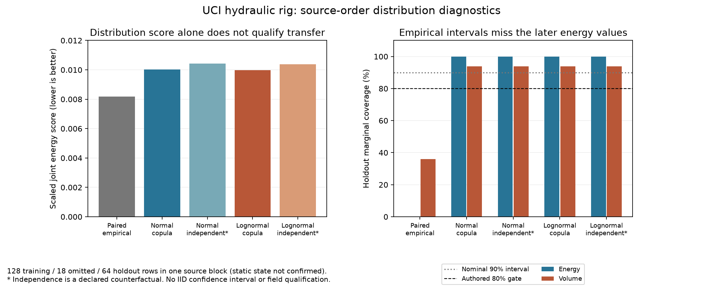

# 관측 자료의 공동 분포 적합과 별도 구간 평가

`pipeline_integrity.uncertainty_fit`는 기존 공동 표본 전파 앞에 자료 적합과 평가를
연결한다. 학습 행만으로 주변분포와 잠재 정규 상관을 적합하고, 사용자가 정한
나중 행에서 구간 포함률과 공동 energy score를 계산한다. 적합 성공·수치 평가
성공·선언 기준 통과·현장 자격을 각각 다른 정보로 반환한다.

## 계약과 설치

SciPy는 기존 선택 설치 `.[engineering]`를 사용한다. 원 관측·프로토콜 검토와
자료 수 확인은 핵심 의존성만으로 가능하다. 검토를 마친 수치 적합과 평가에는
SciPy가 필요하다. 별도의 통계 엔진을 복사하거나 새 의존성을 추가하지 않았다.

| API | 입력과 역할 |
|---|---|
| JointObservation | 원 행 ID·순서·원 그룹·조건·짝을 유지한 값/품질·근거 |
| JointObservations | 변수/단위·원 행·순서 기준·소스 SHA-256·RunContext |
| DistributionFitRequest | 학습/평가 ID·주변분포·단위별 점수 척도·분할·최소 행 수 |
| fit_joint_distribution | 학습 행만으로 모수와 normal-score 상관 적합 |
| DistributionUse | 원 행/상관/독립 반사실·표본 방법·해석·대상 조건·적용 검토 |
| distribution_design | 기존 generate_ensemble로 전달할 봉인된 design 생성 |
| DistributionAssessment | 구간 분위수·선택 기준·거리 계산 예산 |
| assess_joint_distribution | 미사용 평가 행의 진단과 선언 기준 판정 |

변수에는 기존 UncertainVariable을, 점수 척도에는 기존 inverse.ResidualScale을
재사용한다. 변수의 marginal은 원 관측 계약에서 비워 둔다. 각 행에 모든 값과
valid 키가 있어야 하며 미상은 None/False다. 단위·근거·원본 해시가 필요하다.
원 행과 선택 ID는 정렬하거나 섞지 않고 엄격하게 증가하는 순서를 요구한다.

## 학습과 평가 분할

training_ids와 validation_ids는 명시한 고유 ID이며 서로 겹칠 수 없다.
평가 첫 순서는 마지막 학습 순서보다 minimum_order_gap 이상 뒤여야 한다.
이 값은 **선언한 순서 좌표의 차이**다. 예를 들어 127 뒤에 146을 쓰면 차이는
19이고 사이의 18행은 사용하지 않는다. 이 좌표를 초나 독립 시행 수로 바꾸지 않는다.

group_disjoint는 실제 원 그룹의 교집합도 거부한다. ordered_gap은 같은 그룹의
나중 구간을 허용하지만 독립 평가라고 주장하지 않는다. 두 정책 모두 독립성·
정상성·현장 성능을 자동 인증하지 않는다. 최소 학습/평가 행 수는 기본 30/10이다.
이는 연구자가 선언한 프로토콜의 최소 크기이며 통계적 충분성을 보장하지 않는다.

학습 행에 하나라도 미상·무효 값이 있으면 needs_data로 반환한다. 유효 행만
따로 선택해 원 분포인 것처럼 적합하거나 결측을 채우지 않는다. 학습 조건이
섞이거나 지정한 condition_id와 다르면 out_of_scope다. 사용하지 않은 행 ID와
원 그룹의 겹침, 실제 완전 행 수를 기록한다.

평가 값은 적합 모수나 상관 추정에 사용하지 않는다. 전체 원 자료의 해시는
평가 자료 변경도 탐지하지만 training_only_digest는 학습 행과 변수·조건에만
의존한다. 평가 값을 바꿔도 적합 모수·상관·이 해시가 같아야 한다.

## 적합하는 분포와 의존성

주변분포는 변수마다 **사전에 정한** normal/lognormal을 지원한다.
SciPy의 최대우도 적합을 사용하며 lognormal은 location=0으로 고정한다.
로그 평균과 표준편차는 자연로그 공간의 값이다. 비양수 자료가 있는 로그정규
후보는 보류한다. 상수 채널에는 임의의 작은 표준편차를 넣지 않는다.

상관은 각 학습 열의 평균 순위에 (rank-0.5)/n을 적용하고, SciPy norm.ppf로
바꾼 정규 점수의 Pearson 상관이다. 동률은 평균 순위를 사용한다. 이는 실제
단위 공간의 Pearson 상관이 아니다. 마지막 비트 수준의 대칭 오차는 명시적으로
평균하고 그 크기를 기록하며, 유의한 비양의 준정부호 행렬을 고치지 않는다.
기존 EnsembleRequest가 PSD와 특이 상관·반올림 허용오차를 검사한다.

세 가지 predictive design을 명시적으로 선택할 수 있다.

- empirical_pairs: 원 학습 행의 짝과 동일 비중을 유지한 유한 경험분포.
- normal_score_copula: 적합한 주변분포와 잠재 정규 상관을 함께 전달.
- independent_counterfactual: 같은 적합 주변분포를 독립으로 조합한 명시적 반사실.

주변분포·방법을 평가 점수가 좋아지도록 자동 선택하지 않는다. 대상 조건이
학습 조건과 다르면 out_of_scope이며, 자산이 다르거나 근거가 바뀌면 오류다.
applicability_reviewed가 기본 False다. 검토를 마친 예측 설계도 연구용이고
원 적합의 field_distribution_validated는 False로 유지한다.

## 평가 점수와 보류

공동 energy score는 caller가 선언한 단위별 척도로 나눈 벡터에서 계산한다.
손실 형태 E‖X-y‖ - E‖X-X′‖/2를 사용하므로 낮은 값이 유리하다. SciPy cdist로
유한 설계의 모든 가중 거리 쌍을 계산한다. 대각 쌍도 포함하며 독립 표본의
불편 추정량으로 해석하지 않는다. 거리 쌍 예산을 넘으면 임의 추출하지 않고
needs_data로 보류한다. 비중 합의 수치 정규화 제수도 기록한다.

분위 구간은 기존 NumPy inverted_cdf 가중 분위수를 쓴다. 포함률은 각 변수의
유효 평가 행에서 계산하고 미상 행을 포함한 전체 포함률의 하한/상한을 함께
반환한다. 공동 점수는 모든 변수가 유효한 평가 행에서만 계산한다. 하나라도
미상이면 전체 평균을 null로 두고 조건부 평균과 미계산 비율을 보존한다.
1e-12 이내의 음의 energy score 반올림값은 원값과 개수를 남기고, 그보다 작은
값이나 비유한 거리·점수는 out_of_scope다. 값을 몰래 0으로 바꾸지 않는다.

선택한 판정 기준은 최소 주변 포함률과 최대 평균 공동 점수를 함께 받는다.
criteria를 지정하지 않으면 declared_gate는 not_evaluated다. 기준 실패에도
status=computed일 수 있다. 이는 진단을 수치적으로 계산했다는 뜻이다.
결측이 있으면 기준을 통과시키지 않고 needs_data로 둔다. 이 판정은 검토한
연구 기준이며 현장 자격·정상성·분포의 참값·모델 우월성 증명이 아니다.

## Python 예제

```python
import runpy
from pipeline_integrity.uncertainty_fit import (
    fit_joint_distribution,
    distribution_design,
    assess_joint_distribution,
)

example = runpy.run_path("examples/fit_uncertainty.py")
observations, request, use, criteria = example["make_case"]()
fit = fit_joint_distribution(observations, request)
prediction = distribution_design(fit, use, observations.context)
report = assess_joint_distribution(fit, observations, prediction, criteria)
print(report["status"], report["scores"], report["declared_gate"])
```

prediction['design']은 기존 evaluate_ensemble의 입력이다. 모델의 원 입력 단위와
시계·자산·근거를 유지하고 metadata.distribution_fit과 metadata.ensemble의
출처/표본 좌표를 보존한다. 예제는 독립 작성한 합성 양수 자료이며 실제 가격이나
현장 운전 분포가 아니다. UQ 전파 해석은 UNCERTAINTY_KO를 함께 따른다.

## 실제 자료와 실패 결과

`python scripts/check_uncertainty_fit.py`는 이미 취득한 UCI447 ZIP을 검증하고
EPS1·FS1의 2205회차를 스트리밍한다. 원 전력13230000값·유량1323000값을 읽고
각 회차의 공통 [0,59.9]초에서 전력5991개·유량600개만 사용한다. 명목60초의
끝을 채우거나 센서 시계를 재표본화하지 않는다. 네 위치는 원 로더 및 기존
signed power 적분과 별도로 대조한다. 각 원 파일의 SHA-256도 남긴다.

첫 연속 조건 블록 210행은 원 프로필 [3,100,0,130,1]이다. 마지막 flag=1은
정적 상태에 도달했는지 미확정이라는 표기이며 정상성을 가정하지 않는다. 처음128행 학습·중간18행 미사용·
나중64행 평가로 선언한 조건 안의 분포 변화 진단을 수행했다. 같은 실험 블록이
겹치므로 독립 시험이 아니다. 점수 척도는100000J·0.005m3, 기준은 포함률0.8·
최대 점수1.0으로 사전에 명시한 예시다. 시장·현장 허용 기준이 아니다.

경험분포의 공동 점수는 약0.00817로 후보 중 가장 낮았지만 에너지 포함률0%,
유량 포함률약35.9%로 기준을 실패했다. 정규/로그정규 copula와 독립 반사실은
이 선언 기준을 통과했지만 넓은 구간이나 유한 표본 점수만으로 실제 분포의
적합성·독립성·정상성을 증명하지 않는다. copula 잠재 상관은 약0.839893이다.
평가 점수 차이로 가족/의존성 모델을 자동 선택하거나 기존 모듈에 반영하지 않았다.

별도의 안정 프로필 [100,100,0,90,0]은 전체19행뿐이다. 10학습/6평가/3미사용은
기존30/10 기준을 충족하지 못해 needs_data다. 수를 줄여 성공으로 만들지 않았다.
이 프로필의 축압기 라벨90은 열화 조건이므로 모든 부품이 정상인 상태와 다르다.
모든 부품이 정상인 안정 프로필 [100,100,0,130,0]은10행이다. 6학습/3평가/1미사용
분할도 같은30/10 기준에 따라 needs_data이며 최소 크기를 낮추지 않았다.
전이 조건 분포를 이 안정 조건으로 옮기려는 요청도 out_of_scope로 유지했다.

적합 로그정규 copula의1024표본을 기존 economics.energy와 J/m3 계산에 전달했다.
이는 원 장치의 같은 조건/구간에 대한 연구 전파다. 0.2REF/kWh는 작성한 요금이며
59.9초 구간을 연간 duty·실제 현장 손실·HEP 관측으로 바꾸지 않는다.



## 재현·권리·후속 범위

원 행과 변환 회차 기록·fit/design/개별 점수는 artifacts/uncertainty_fit에만 남긴다.
코드 릴리스의 research/uncertainty_fit_results.json과 그림에는 집계·출처·해시·
실패·한계만 포함한다. 자료는 Helwig·Pignanelli·Schütze의
[UCI447, DOI 10.24432/C5CW21](https://archive.ics.uci.edu/dataset/447/condition+monitoring+of+hydraulic+systems),
CC BY 4.0을 따른다. 작성한 코드/설명과 원 자료의 이용 조건을 구분한다.

적합은 [SciPy lognorm](https://docs.scipy.org/doc/scipy/reference/generated/scipy.stats.lognorm.html)과
[rankdata](https://docs.scipy.org/doc/scipy/reference/generated/scipy.stats.rankdata.html)를 사용했다.
점수의 수학적 정의는 Gneiting·Raftery(2007),
[Strictly Proper Scoring Rules, Prediction, and Estimation](https://sites.stat.washington.edu/raftery/Research/PDF/Gneiting2007jasa.pdf)을
확인했다. 수학적 관계를 독립적으로 구현/설명했으며 원 문장·코드·표를 복사하지 않았다.

uncertainty.coupled는 계속 partial이다. 시간/운전모드 의존 모델·공통원인·중첩
epistemic/aleatory 추론·꼬리 의존성과 희귀사건 오차·분포 모수의 불확실성·검열/
결측 기전·재료 결함/전체 사고 연성·독립 현장 검증이 남는다. normal/lognormal의
모수 적합을 임의의 HEP·고장 빈도 추정기로 사용하지 않는다. 이미 사용한 평가
구간으로 가족·척도·기준을 조정하면 이후에는 새 평가 자료가 필요하다.
