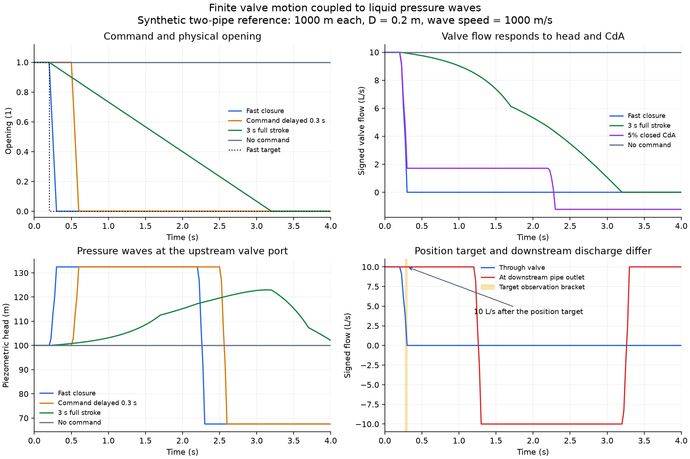

# 밸브 명령·구동과 액체 압력파 연결

밸브 목표 명령, 실제 개도, 밸브 유량과 하류 말단 유량은 서로 다른 값이다.
`valve_motion`은 기존 lh2dt_models의 유한 스트로크 구동기를 호출한다.
`transient.LiquidValve`는 사용자가 제공한 개도–유효 CdA 곡선을 단상 액체
특성선법에 연결한다. 미리 정한 유량을 밸브 개도처럼 사용하는 방식은 아니다.



그림은 합성 기준이다. 오른쪽 아래의 음의 유량은 하류 저장조에서 되돌아오는
방향을 나타낸다. 마찰 없는 액체 관의 수두·체적 변화를 보여주며, 실제 기체
사고의 비가역적인 방출량이나 현장 차단 성능을 검증한 그림은 아니다.

## 실행과 원 증거

Python 3.12와 engineering 선택 의존성을 설치한다. 궤적을 새로 만들 때는
기존 lh2dt_models를 별도 설치하거나 경로로 제공한다. 이미 생성한 JSON
작업의 실행에는 해당 장치 패키지나 HRA 패키지가 필요하지 않다.

```powershell
python examples/valve_transient.py --lh2dt PATH_TO_LH2DT --output artifacts/valve_result.json
pipeline-integrity liquid-transient examples/valve_transient.json --output artifacts/valve_cli.json
python scripts/check_valve_transient.py --lh2dt PATH_TO_LH2DT --hra PATH_TO_HRA
python scripts/review_valve_data.py
# figures 선택 의존성을 설치한 환경
python scripts/plot_valve_transient.py
```

공개 요약은 `research/valve_transient_results.json`, 자료 검토는
`research/valve_data_review.json`, 그림의 소스·파일·도구 해시는
`research/valve_figure.json`이다. 자세한 입력·구동 궤적·압력·유량·수지와
기존 HRA 객체는 로컬 `artifacts/valve_transient`에 남긴다. 원 엔진의 취득
버전과 실제 실행 파일 해시는 별도 기록한다. 원 패키지에 __version__이
없으면 null을 유지하고 버전을 추정하지 않는다.

## 입력과 Python API

| 입력 | 해석 |
|---|---|
| `ConductanceCurve` | 0~1 개도와 증가하는 유효 CdA(m²), 자료 출처, 선형 구간 또는 PCHIP 보간 |
| `ValveCommand` | 고유 ID·같은 시계의 명령 시각·목표 개도·근거 |
| `ValveMotionRequest` | 밸브 ID, 초기 개도, 전 스트로크 시간, 표본 시각, 명령 목록과 곡선 |
| `LiquidValve` | 두 접점, 유효 CdA 이력, 초기 부호 있는 체적 유량과 근거 |
| `LiquidTransient` | 액체·관·수두/실제 인출 경계, 밸브 목록, CFL 격자·수치 예산·범위·잔차 허용값 |

```python
from pipeline_integrity.valve_motion import (
    simulate_valve_motion,
    liquid_valve_from_motion,
)
from pipeline_integrity.transient import simulate_liquid_transient

motion = simulate_valve_motion(motion_request, valve_context)
valve = liquid_valve_from_motion(
    motion,
    start_node="left",
    end_node="right",
    initial_volume_flow_m3_s=0.01,
    network_context=network_context,
)
# network_specification은 위의 valve를 valves 튜플에 포함한다.
result = simulate_liquid_transient(network_specification, network_context)
```

구체적인 객체 생성은 `examples/valve_transient.py`의 make_case를 따른다.
개도 곡선·구동 시간·명령 시각·누설·관망·물성·초기 상태를 교체할 수 있다.
곡선은 유효 CdA이므로 단순 보어 면적과 혼동하지 않는다. 예제의 3점 곡선은
직접 작성한 가정이며 제조사나 모든 밸브의 기본 특성이 아니다. 닫힌 위치의
CdA가 양수이면 완전한 개도 목표에 도달해도 유량이 남을 수 있다.

## 구동 궤적과 시계

원 구동기의 opening·target·set_target_opening·advance를 사용한다. 명령을
받은 즉시 물리 위치가 변하는 공급자는 거부한다. 명령 시각을 표본 격자에
임의로 반올림하지 않고 별도 궤적 매듭으로 유지한다. 새 명령이 이전 동작을
중단하면 superseded_at_s를 남긴다. 관측 시간창 안에 목표에 도달하지 않은
경우 완료 시각을 만들어 넣지 않는다.

completion_bracket_s는 설정한 position_tolerance 안에 처음 들어온 두 표본
사이의 구간이다. 실제 연속 완료 시각의 직접 관측이나 유량 차단의 판정이
아니다. 원 개도와 CdA를 0으로 잘라서 완료를 만들지 않는다. 표본 간격과
특성선법 실제 시간 간격이 주는 해상도를 함께 검토한다. 미완료 궤적을
짧게 계산한 뒤 나머지 해석 기간에 정지한 것으로 연장하는 입력은 거부한다.

기존 구동기 클래스는 Valve 객체를 요구한다. 이 경계에서는 그 형식만
사용하고 유체 계산은 금지한 공급자를 넣는다. 물의 압력파에 수소 물성이나
기체 유출 계산을 적용하지 않는다. 실제 CdA는 별도 곡선에서 온다. 독립
구동기 생성 API의 안정화 요청은 PI-X01에 있다. 이 구동 모형은 고정 속도
제한이며 압력 토크·스틱션·히스테리시스·구동력 부족은 검증하지 않았다.

## 수력 경계와 보존

해석 변수 H는 피에조 수두 z + p_gauge/(rho*g)다. 밸브 유량의 양의 방향은
start_node에서 end_node로 정의한다. 열린 밸브는 다음 준정상 손실을 따른다.

`H_start - H_end = Q * abs(Q) / (2*g*(CdA)^2)`

각 시각에 특성선에서 들어오는 조건, 접점의 연속식, 밸브 손실식을 동시에
푼다. 병렬 밸브와 공유 접점을 처리하며 역류를 같은 부호 규칙으로 유지한다.
CdA가 0이면 유량은 0이고 양단 수두가 같을 필요는 없다. 밸브 자체의 저장
체적·관성·이동 경계 일은 포함하지 않는다. 출력 dissipated_power_w는 이
근사 모형의 rho*g*Q*수두차이며, 전체 열·기계 에너지 수지를 뜻하지 않는다.

접점에는 실제 인출과 기존 대기 방출 경계도 함께 둘 수 있다. 일반 인출
접점에는 적어도 한 관이 연결되어야 한다. 관이 없는 밸브 단독 경계는
고정 수두 저장조로 표현한다. 밸브끼리만 연결한 무체적 일반 접점과 탱크
용량의 동적 변화는 현재 경계에 포함되지 않는다.

수치는 SciPy의 TRF와 구간별 해석 Jacobian을 사용한다. 유량 변수를 현재
CdA의 용량으로 무차원화해 작은 개구에서 1/(CdA)^2를 직접 계산하지 않는다.
최적화 종료 메시지와 별도로 실제 SI 연속식·수두 잔차를 검사한다. 허용값을
넘으면 그 시각의 물리 이력을 채택하지 않고 withheld로 끝낸다. 단위·스케일·
평가 횟수·최대 미지수와 원 해석 모듈 해시를 기록한다.
[수치 라이브러리의 정의](https://docs.scipy.org/doc/scipy/reference/generated/scipy.optimize.least_squares.html)는
최소제곱의 정지 조건이 물리 방정식의 정확한 해를 자동 보장하지 않음을 이해하는 데 사용한다.

전체 체적 수지만 맞아 관별 오차가 상쇄되는 일을 피하도록 각 관의 선형화
저장량과 양 끝 유량 적분도 따로 기록한다. all_volume_balances_within_tolerance와
접점·밸브 잔차를 함께 확인한다. model_version은 2이며 기존 밸브 없는 계산은
SciPy 없이 계속 사용할 수 있다. 공동화·공기 유입·2상·펌프 관성은 남아 있다.

## 기준 사례의 실제 결과

밀도 998 kg/m³, 파속 1000 m/s, 길이 1000 m·직경 0.2 m인 두 관을 사용했다.
초기 체적 유량은 0.01 m³/s, 밸브 수두차는 5 m다. 빠른 폐쇄의 이론적
수두 상승 32.458575 m와 계산값이 일치했다. 0.025/0.0125초 격자의 공통
시각 결과를 비교했고, 0.3초 명령 지연에 따른 이력 이동 오차는 약
4.3e-14 m였다. 이는 합성 수치 기준이며 독립 현장 정확도는 아니다.

목표 개도 관측 구간은 약 0.275~0.300초였다. 이 시각에 밸브 유량은 0으로
계산됐지만 하류 말단 유량은 여전히 0.01 m³/s였다. 이후 0.5초의 순유출량은
0.005 m³다. 닫힘 CdA를 전개도 값의 5%로 둔 사례에서는 목표 도달 뒤에도
약 0.00171446 m³/s가 밸브를 통과했다. 개도 목표를 유량 차단이나 사람의
실패/성공으로 바로 바꾸지 않는다. 느린 폐쇄·무명령·역류도 따로 계산했다.

## HRA와 공개 실험 자료

`motion_frames(motion)`은 개도·목표·CdA를 기존 SignalFrame으로 만든다.
HRA의 기존 hra_signal_series로 161개 개도 값을 실제 전달했다. 단위 1·
elapsed 시계와 simulation 기원을 유지한다. 개도도 0~1이지만 실패확률이
아니다. 입력 명령이 measured라도 계산한 개도는 simulation이다. 원 궤적과
해시·곡선·명령 근거를 별도로 보관하며, timing 효과가 포함된 HRA 추정값에
같은 시간 저감을 다시 곱하지 않도록 사건의 물리적 목표를 정의한다.

이미 확보한 [UCI 유압 실험](https://archive.ics.uci.edu/dataset/447/condition+monitoring+of+hydraulic+systems)의
2205회차 프로필과 두 설명 파일을 다시 검사했다. 밸브 등급 73·80·90은 각각
360회, 100은 1125회다. 이 등급은 장치 상태 범주이며 개도나 스트로크 시간,
HEP로 변환하지 않는다. 자료는 Helwig·Pignanelli·Schütze,
DOI 10.24432/C5CW21, CC-BY-4.0의 출처를 유지한다.

이 실험의 공개 센서 행렬은 조건 평가에 유용하지만 현재 합성 관망의 기하학·
명령·실측 이동·유체·압력 기준과 대응시킨 검증이 아니다. 같은 실험 장치의
반복 회차를 독립 시행으로 간주하지 않는다. 실제 보정에는 조건 조합·시계별
분할과 대응 근거가 더 필요하다. 원 센서 행렬·설명문·프로필 행은 배포에서 제외한다.
