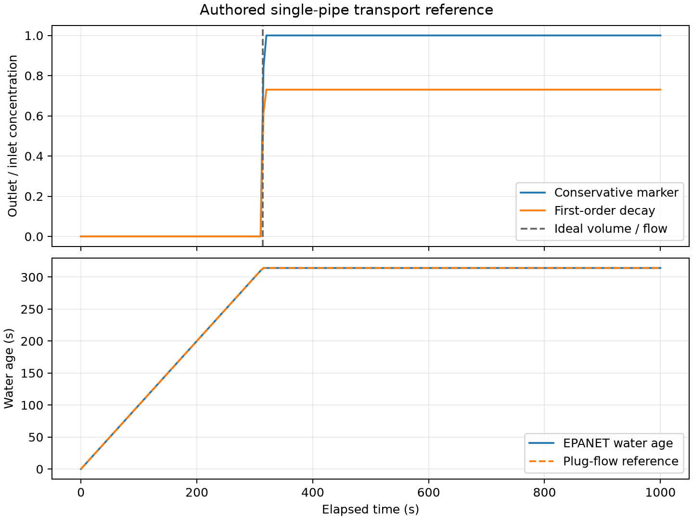

# 물 관망의 성분 수송과 체류시간

`water_quality`는 WNTR가 제공하는 EPANET 2.2 엔진을 호출한다. 별도의 관망
수송 해법을 복제하지 않는다. 사용자가 저장한 INP의 배관·장치·수요·운전
경계를 사용하고, 성분의 초기 상태·주입·반응 조건은 명시적인 요청으로 받는다.
현재 대상은 일정 밀도의 물과 희석 성분이다.

## 실행

```powershell
pipeline-integrity water-quality examples/water_quality.json --output artifacts/quality.json
python scripts/check_water_quality.py --monitoring PATH_TO_MONITOR
```

JSON의 `network`는 작업 파일이 저장된 디렉터리를 기준으로 해석한다. 예제의
관망과 경계는 독립적으로 작성한 합성 기준 사례다. 공개 관망 적용을 재현하려면
데이터 취득 명령으로 BattLeDIM의 `L-TOWN.inp`를 먼저 확보한다. 다운로드한
원본과 외부 관망에서 생성된 전체 시계열은 배포 패키지에 포함하지 않는다.

```python
from pipeline_integrity.contracts import RunContext
from pipeline_integrity.water_quality import (
    WaterQualityRun,
    simulate_water_quality,
    water_quality_batch,
    quality_threshold_arrival,
)

# job.json의 specification은 examples/water_quality.json과 같은 구조다.
import json
from pathlib import Path

job_path = Path("examples/water_quality.json")
job = json.loads(job_path.read_text(encoding="utf-8"))
spec = WaterQualityRun.model_validate_json(json.dumps(job["specification"]))
context = RunContext.model_validate_json(json.dumps(job["context"]))
result = simulate_water_quality(job_path.parent / job["network"], spec, context)
if result["status"] == "computed":
    arrival = quality_threshold_arrival(result, "J", 0.0005)
    # 기존 모니터링 패키지를 설치한 환경에서 실제 SignalBatch를 생성한다.
    batch = water_quality_batch(result, node_ids=("J",))
```

## 세 가지 계산 의미

| mode | 입출력 단위 | 의미 |
|---|---|---|
| concentration | kg/m³ | 물 체적당 선택 성분의 질량 |
| age | s | 계산 경계에서 정의한 물의 평균 경과시간 |
| source_fraction | 1 | 지정한 노드에서 유래한 물의 체적 비율 |

`source_fraction`의 0~1 값은 사건 확률·검출확률·HEP가 아니다. 엔진의 원래
백분율 출력을 이 API 경계에서 비율로 변환한다. `age`의 원시 시간 단위도
초로 변환한다. `quality_tolerance`와 `admissible_value_error`는 해당 mode의
입출력 단위를 사용하며, 질량수지 비 허용오차는 무차원이다.

농도 계산은 `species_id`를 요구한다. 이 ID는 표지 성분의 식별자이며 이름을
입력했다고 물질의 독성·반응 상수·물성이 자동으로 주어지지 않는다. `age`와
`source_fraction`에 성분 주입이나 반응 계수를 넣으면 거부한다. 출처 추적은
EPANET의 시작 조건에 맞춰 초기 비율 0만 허용한다.

## 주입과 반응

`WaterQualitySource`는 주입 ID·노드·유형·세기·단위를 받는다. 한 노드에 여러
주입을 중첩하지 않는다. 여러 경계가 필요한 경우 서로 다른 노드를 사용한다.

| source_type | strength 단위 | 사용 의미 |
|---|---|---|
| CONCEN | kg/m³ | 외부에서 유입되는 물의 농도 조건 |
| MASS | kg/s | 시간당 추가되는 성분 질량률 |
| FLOWPACED | kg/m³ | 유량에 비례한 농도 증가 |
| SETPOINT | kg/m³ | 해당 노드의 농도 설정값을 위한 주입 |

농도 조건은 모든 노드의 농도를 무조건 고정하는 경계가 아니다. 유입·유출과
노드 유형에 따른 원 엔진의 의미를 따른다. 저장된 INP의 주입원을 먼저
제거하고 제거된 ID·노드를 결과에 남긴다. 초기 농도도 모든 노드에 명시적으로
설정한 뒤 `initial_node_values`를 적용한다. 원본 파일 자체는 수정하지 않는다.

현재 반응은 사용자가 제공한 0 이상의 `bulk_decay_per_s`를 일차 소멸률로
사용한다. 관별 `pipe_bulk_decay_per_s`로 바꿀 수 있다. 탱크에는 전역 소멸률을
적용한다. 원본의 전역/관별 벽 반응·다른 차수·포화 반응을 이어받지 않는다.
탱크 혼합 방식은 입력 관망의 설정을 유지한다. 다성분 반응은 아직 지원하지 않는다.

## 시간과 예산

`QualityStepPattern`의 시각은 0에서 시작하는 증가하는 정수 초다. 각 배수는
다음 절점 전까지 유지되고 마지막 값은 계산 끝까지 유지된다. 활성 주입 절점을
원래 수요 패턴의 간격·시작 오프셋과 최대공약수 격자로 맞춘다. 기존 수요
패턴의 주기와 위상을 유지하지만 수력 사건 격자가 더 촘촘해질 수 있다.
상수 주입이나 계산 종료 후에만 변하는 주입은 기존 시계를 재설정하지 않는다.

`start_time_s`는 상위 시계의 오프셋이다. 결과의 `time_s`에는 오프셋이 있고
`elapsed_time_s` 및 내부 수력 이력은 계산 시작 후 경과시간이다. 원 관망의
운전 패턴 시작 오프셋은 이 상위 시계 오프셋과 별개다. `clock_id`를 함께
보존하고 모니터링 결과에 자산·시나리오·파라미터 출처·결과 해시를 전달한다.

수력·보고·수송 간격은 정수 초다. 원본의 지연 보고나 시간 평균 출력은
사용하지 않고 시작 0·시점별 결과를 사용한다. 보고 종료시각이 계산 끝과
나누어떨어지지 않으면 마지막 보고 이후 구간의 도달을 추정하지 않는다.

패턴 값 수와 반환 배열 크기에는 사전 예산이 있다. `maximum_nominal_quality_steps`는
명목 간격의 추정 상한이며 제어 사건에 따른 엔진 내부 수송 횟수의 강제 상한은
아니다. 실제 수력 단계는 `hydraulics.maximum_hydraulic_periods`로 제한한다.
수송 실행시간의 강제 제한이 필요하면 호출자가 별도 프로세스로 관리해야 한다.

## 수치 판정과 보류

공통 `epanet` 실행 경로가 수력 단계별 경고·최대 반복 수·상대 오차·수두 오차·
유량 변화를 읽는다. 경고 세부 정보는 처음 32개를 보존하고 총 횟수와 잘림
여부를 별도 기록한다. 접점 수지가 작아도 경고·수렴 기준·시간 완료 검사에
실패하면 보류한다. 순수 수력 API에도 같은 기준을 적용한다.

성분 결과는 유한값·하한·출처 비율 상한·보고 시계·엔진 종료시각·수송 수지 비를
추가로 검사한다. 수지 비는 농도에서는 반응을 포함한 성분 질량, 출처 추적에서는
출처 비율×체적, 물 나이에서는 노화에 의한 생성을 포함한 시간×체적의 장부다.
세 의미를 모두 성분 질량 검증이라고 부르지 않는다. 엔진이 반환한 전체 수지
진단이며 구간별 독립 장부를 추가 구현한 것은 아니다.

일관된 주입 단위를 위해 엔진 입력을 L/s와 수두 m로 직렬화한다. 검증 환경의
EPANET 2.2는 내부 변환에 일부 반올림 상수를 사용한다. 단일 관의 이상적 SI
체적/유량 시간과 원 엔진 단위 기준의 시간을 함께 기록한다. 원 응답을 사후
보정하거나 이유 없이 허용오차를 넓히지 않는다.

현재 Windows/WNTR 1.5.0/EPANET 버전 코드 20200에서 확인했다. WNTR의 프로젝트
핸들을 통해 EPANET 2.2 공개 C API를 호출하므로 다른 WNTR 배포판에서 핸들
형식이 달라지면 명시적으로 실패할 수 있다. 엔진 라이브러리·직렬화 모델·
호출 코드의 해시와 버전을 실행 결과에 보존한다.

`water_quality_frames`와 `water_quality_batch`는 `computed`와 내용 해시를
확인한다. 보류 결과는 진단용 원자료로 보존되지만 검증된 모니터링 입력으로
승격되지 않는다. `quality_threshold_arrival`은 첫 보고값의 상향 임계값 도달
구간만 반환한다. 시작부터 초과한 경우를 표시하고, 미도달은 보고된 기간에
한정한다. 정확한 연속 도달시각·독성 노출·사건 확률을 출력하지 않는다.

## 검증과 현재 제한

단일 관의 체적/유량 도달시간·물 나이·일차 반응 지수해, 대칭 두 유입 혼합,
세 주입 유형의 단위, 주입 사건과 원 수요 위상 보존을 검사한다. 합성 기준의
실제 모니터링 `SignalBatch` 전달도 별도 실행한다. 결과와 자체 작성 그림은
`research/water_quality_results.json` 및 아래에 있다.



공개 L-TOWN에서는 명시적으로 만든 품질 초기/경계 조건을 적용한다. 이는
공개 자료의 실제 수질 관측을 재현한 사례가 아니다. 현재 엄격한 수력 조건에서
반복 초과 경고가 발생해 세 mode를 보류한다. 반복 한도 증가와 감쇠 변경의
진단에서도 경고가 남아 경고 예외를 추가하지 않았다. 원본 관망을 수정해
성공 사례로 바꾸지 않는다. 이전 순수 수력 경로의 수지 통과만으로 computed였던
판정은 이 공통 진단 도입으로 정정한다.

석유 다품종의 밀도·점도 변화, 축방향 분산, 열·상 변화, 벽 흡착, 다성분 반응과
피그 이동은 후속 범위다. `transport.batch_interface`는 이 수송 기반을 근거로
partial이며 다품종 제품 이송 모델 전체의 완료로 집계하지 않는다.
외부 다품종 해석 결과는 [배치 수송 공급자 경계](BATCH_TRANSPORT_KO.md)로 받는다.
그 adapter가 있어도 이 물 수질 결과를 제품 배치 해석으로 변환하거나 검증한 것은 아니다.

## 공개 기술 근거

- [WNTR 수질 모드와 주입](https://usepa.github.io/WNTR/waterquality.html)
- [WNTR 단위](https://usepa.github.io/WNTR/units.html)
- [EPANET 2.2 수지 계산](https://github.com/OpenWaterAnalytics/EPANET/blob/v2.2/src/quality.c)
- [EPANET 2.2 공개 API와 통계](https://github.com/OpenWaterAnalytics/EPANET/blob/v2.2/src/epanet.c)
- [수력 반복 초과 경고의 정의](https://github.com/OpenWaterAnalytics/EPANET/blob/v2.2/src/report.c)
- [엔진 단위 상수](https://github.com/OpenWaterAnalytics/EPANET/blob/v2.2/src/types.h)

공개 관망의 작성자·이용 조건·원본 해시는 데이터 카탈로그와 실행 요약에
유지한다. 이 문서의 설명과 예제는 독립적으로 작성했다.

## 수렴 옵션 적용의 추가 확인

보정 모듈을 구축하며 WNTR 1.5의 원시 FLOWCHANGE 직렬화와 EPANET INP 파서의
작은 ACCURACY 제한을 추가로 확인했다. 현재 공통 경로는 SI 유량 변화 한도를
L/s로 변환하고 setoption/getoption으로 요청 수렴값과 실제 적용값을 맞춘다.
이 수정 후 기준 사례와 세 공개 관망 mode를 다시 실행했다. 엄격한 공개
관망은 여전히 수력 보류다. 최신 실행의 경고 코드·옵션·수지·코드 해시를
확인하며 과거 경고 번호만으로 현재 상태를 추정하지 않는다.
